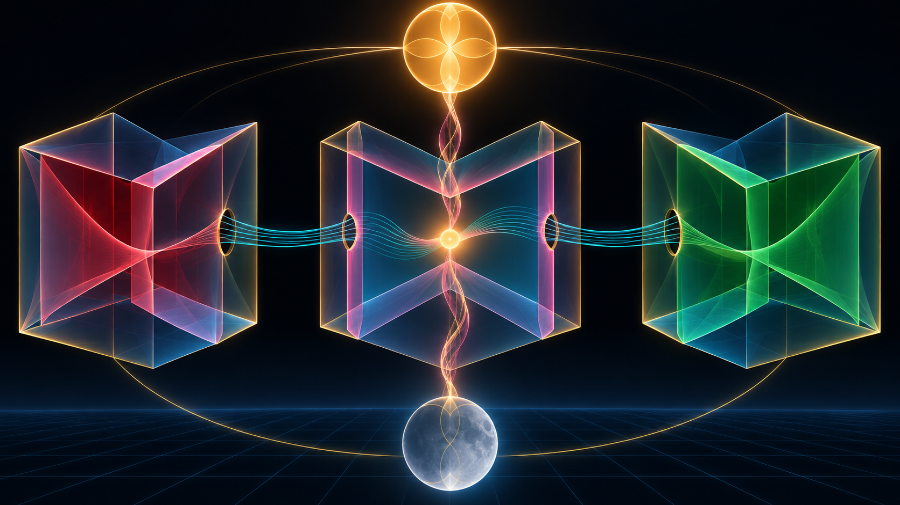

# FIELD NOTES A0 - Void, mirror center and the 101 -> 202 -> 404 ladder

Date: `2026-10-08`

Updated: `2026-11-06` · Als private Owner-Handbuchnotizen rückgebunden; 12-Schichten-Cube-/Shell-Lesekarte ergänzt; ältere Einträge behalten ihren eigenen Stand.

## Owner-Handbuchnotizen · Ideenparkplatz

Hier sammelt der Human Owner Beobachtungen, Bilder, Begriffe und mögliche
Verbindungen, ohne dem nächsten Gedanken sofort zu folgen. Diese Field Notes
sind damit die privaten, fortschreibbaren NEXAH-Handbuchnotizen des Owners:
ein Lesebuch für Herkunft, Wiedererkennung, offene Fragen und spätere
Rückbindung — keine zweite wissenschaftliche Autorität und kein Ersatz für
Science Desk, Protokoll, Backlog, Navigator oder kanonische Quellen. Der
aktuelle Arbeitsfaden bleibt stehen, während neue Ideen einen
wiederauffindbaren Ort bekommen.

**Arbeitsstand:** Der Dokumentationsschnitt vom 20.10.2026 ist im
[Forschungsprotokoll](../22_A0_FORSCHUNGSPROTOKOLL_BUCH_UND_RAHMEN_2026-10-10.md#documentation-closeout-20261020)
und [Backlog DOC-01–12](../24_A0_RESEARCH_BACKLOG_AND_OPEN_JOINTS_2026-10-10.md#documentation-followups-20261020)
nachgeführt; offene Abnahme und Integritätsfragen bleiben dort sichtbar.
Die folgenden Ideen sind geparkt, nicht als Forschung,
Implementierung oder neue Begriffsdefinition aktiviert.

### Einen Gedanken ablegen

Für einen neuen Eintrag reichen zunächst Datum, Gedanke und Kontext oder
Quellverweis. Die offene Frage und ein möglicher Wiederaufnahme-Anlass können
später ergänzt werden. Fehlende Angaben bleiben offen; sie werden nicht durch
eine plausible Geschichte ersetzt.

```text
Datum und kurzer Titel:
Gedanke oder Beobachtung:
Kontext und Quelle oder Bild:
Offene Frage:
Wieder aufnehmen, wenn:
Stand: geparkt / zur Sichtung / in bestehende Arbeit überführt / verworfen
Bei Überführung: Ziel und Datum:
```

Das ist eine Notizform, keine zusätzliche Registry. Neue Begriffe bleiben
Arbeitswörter, bis sie an einer konkreten Quelle oder Aufgabe präzisiert sind.
Erst eine ausdrückliche Auswahl führt einen Gedanken in ein bestehendes
Instrument, den Forschungsbacklog oder eine gesondert zugelassene Frage über.
Erledigte oder verworfene Gedanken behalten ihren Verweis und ihre Disposition.

### Redaktioneller Schnitt · vier Adapter-Lanes

Die vielen Einzelnotizen werden nicht zu einer gemeinsamen Theorie verdichtet.
Für die weitere Arbeit gelten vier redaktionelle Lanes, die vorhandene Quellen
und zulässige nächste Schritte auseinanderhalten:

1. **Carrier / Adresse:** `101/A0 World Cube`, `11³`, D1–D12, J-Zähler,
   Shared I-Axis und `0…28` werden nur über deklarierte endliche Adressen,
   Zustände und Returns verglichen.
2. **Relation / Grenze:** `A ↔ CC ↔ B`, Mask–Membrane–Turn, HZ/FZ und
   Pause/Ton benötigen einen typisierten Übergangs- oder Ereignisrecord;
   Bildnähe allein reicht nicht.
3. **View / Projektion:** C&A/Ca, vier Plates, zwei Shades, Pink Diamond,
   Ghost Grid, Nautilus und Lotus bleiben Ansichten mit eigener Provenienz.
   Eine Ansicht verändert weder Source Record noch Evidenzklasse.
4. **Analogie / Quarantäne:** String-/M-Theory, chemische Wortspiele,
   kosmische oder biologische Lesarten bleiben Owner-Handbuchnotizen, bis ein
   Fachobjekt, eine Gleichung, Einheit, Quelle und Prüffrage ausdrücklich
   gebunden sind.

Die erzeugte Leseseite zeigt diese Ordnung als
[Mathfield Adapter Matrix](assets/a0-field-notes/index.html#mathfield-adapter-matrix).
Sie ist ein redaktioneller Router zu bestehenden A0- und 101-Quellen, keine
neue Registry, Study, Family, Relation oder wissenschaftliche Aktivierung.

##### Motion Overlay · V↑/V↓, Wobble und Jumping Needle

Die vier Adapter-Lanes bleiben unverändert. Bewegung ist keine fünfte Lane,
sondern eine getrennte Anzeige über einem bereits gewählten Carrier oder View.
Das vorhandene `VV₈`-Modell enthält diese Ebene bereits:

```text
theta_k = k*pi/4
V_up(k) = A*sin(theta_k)
V_down(k) = -V_up(k)
sum = 0
delta = 2*A*sin(theta_k)
7 -> 0 = diskreter Return
```

`V↑/V↓` bezeichnet damit zwei gegenläufige Displaykanäle auf einem gemeinsamen
Takt. **Wobble** darf nur eine begrenzte Abweichung um eine deklarierte
Referenz meinen; dafür fehlen noch Zeitbasis, Amplitude, Toleranzband und
Observable. **Jumping Needle** bezeichnet dagegen höchstens einen diskreten
Sprung zwischen zwei adressierten Zuständen oder eine Schwellenkreuzung. Ein
Sprung ist nicht dasselbe wie ein kontinuierliches Wobble.

Der Reader zeigt diese Unterscheidung als
[Motion Overlay](assets/a0-field-notes/index.html#motion-overlay-intake).
Aktueller Status: `EXISTING VV8 MODEL / NEW VISIBILITY / REVIEW QUESTION`.
Neue Lane `0`, neuer Carrier `0`, Study `0`, Finding `0`, Physikclaim `0`.

Unter der Matrix verbindet der
[Janus-K3-Adapter](assets/a0-field-notes/index.html#janus-k3-adapter) zwei
bereits getrennt typisierte Lesarten: Visual 1 übernimmt den Root-/Grid-
Transport mit weißen `sqrt(2)`-Ticks, `sqrt(5)`-/`sqrt(7)`-Shells und
separaten 7-/11-View-Grids; Visual 2 zeigt die exakte Faktorisierung
`1001=7*11*13` als drei Adresskanäle. Das Tripel ist keine Base-3-Darstellung.
Die in der Quelle berichtete empirische Auflösung `1/1001`, die arithmetische
Faktorisierung und der Owner-Ausdruck „Janus triple mirror“ bleiben drei
verschieden typisierte Aussagen. `Innen -> Schwelle -> Innen'` bezeichnet
einen Return mit erhaltenem Schlüssel, nicht die Gleichheit von Innen und
Innen'. „Julia Pearls“, Eule/Euler-Rim und `iAM CH(40) A irOS` bleiben
Arbeitswörter auf `HOLD`, bis Quelle und Operator einzeln deklariert sind.

Die ergänzte Body-Linse liest exakt `13+11=24`, `24+7=31`, `24-7=17` und
`31+17=48`. `24 +/- 7 = {31,17}` ist dabei eine symmetrische
Adressdarstellung, kein Schließungstheorem. Die sichtbare Return-Grammatik
`1 -> 0(Q) -> 1'` bedeutet Innen -> Außen/Grey Space -> zurückgekehrtes
Innen. Im `0(Q)`-Aperturkreis bleibt eine `1` als gehaltene Lesemarke
sichtbar. Ringriss und Ghost Snake zeigen Schwelle und Wegspur; sie definieren
weder einen Nullwert noch einen Träger oder eine physische Mechanik. MP, FBF
und S-Cross bleiben ebenso wie die übrigen Owner-Wörter auf `HOLD`.

**Desk-Rückbindung:** Der [A0 Science Desk](A0_RESEARCH_DESK.html#a0-owner-handbook-notes-binding-20261105)
hält Evidenzstatus, Claim Ceiling und nächste zulässige Aktion; der
[kanonische Backlog](../24_A0_RESEARCH_BACKLOG_AND_OPEN_JOINTS_2026-10-10.md#a0-owner-handbook-notes-binding-20261105)
nimmt nur ausdrücklich ausgewählte Aufgaben auf. Builder-, Navigator- und
Mission-Control-Wege werden erst bei einer solchen Auswahl berührt. Das
Handbuch selbst aktiviert nichts.

### Gesammelte Gedanken vom 20. Oktober 2026

Die folgenden Einträge verdichten Owner-Hinweise aus dem sichtbaren Faden.
Sie sind keine wortgetreue Gesprächsmitschrift und keine neuen Ergebnisse.

#### Eine verdrehte Fläche mit großer und kleiner Schlaufe

**Gedanke:** Das gesuchte Visual zeigt möglicherweise nicht zwei unabhängige
Grids, sondern eine Fläche, die sich verdreht und zwei verschieden große
Schlaufen bildet. Die Erinnerung bleibt als Suchhinweis erhalten.

**Offen:** Welches Originalbild, welche Randverklebung und welche tatsächliche
Nachbarschaft sind gemeint? Möbius-, Torus- und bloße Projektionsbilder nicht
vorab gleichsetzen. Wieder aufnehmen, wenn das konkrete Visual gefunden ist.

#### Sechs Teller und eine gemeinsame Mitte

**Gedanke:** Die Owner-Lesart verbindet 6+1 und 6|1|6 mit einer gelben/goldenen
Mitte, im Gespräch auch „gelber Chor“ genannt. Vorhanden sind sechs MUINDI-
Teller und separat der CON–DAO-Träger mit sechs Adressen je Seite und einem
goldenen Stillpoint.

**Offen:** Ist die Mitte ein weiterer Teller, eine Referenz, eine Kopplungsrolle
oder etwas anderes? Ein Siebener-Tellerstapel ist damit noch nicht identifiziert.
Quelle: [CON–DAO-Modell](../../../SCIENCE_LAB/CASE_STUDIES/NEXAH_CON_DAO_JANUS_BREATH_SEQUENCER_2026-10-06/README.md).

#### Die Farben der Einsen und der Kontext der Dreiergruppen

**Gedanke:** Gleichwertige „1er“ können je nach Dreiergruppe, Rolle und
Matroschka-Ebene cyan, gold oder anders erscheinen. Beim Rückführen soll
ihre Herkunft erkennbar bleiben, auch wenn sie in der Ansicht verdeckt wird.

**Offen:** Die konkrete Farb-/Gruppenzuordnung wiederfinden; keine globale
Farbtabelle aus lokalen Paletten ableiten. Grün als Kopplung, Gelb als
Fusion/Return sowie die Zeichen ị und }{ bleiben kontextgebundene Owner-
Lesarten. Auch P=A+B verlangt zuerst einen deklarierten additiven Raum.

#### Die Tube als Verteiler und Rückführung

**Gedanke:** Zahlencontainer, Adressen und lokale Rollen werden durch einen
Übergang verteilt und wieder zusammengeführt.

**Offen:** Eingangsrecord, Routingregel, Ausgangsadresse und Rückschlüssel
für genau einen Fall bestimmen. Historischer Kohärenzgenerator, endlicher
C10-Tube-Operator und Zylinderansicht sind noch kein gemeinsamer Verteiler.
Quelle: [gesicherte Tube-Herkunft](results/a0-tube-operator-lineage-return-2026-10-20.json).

#### Zahlen als Adressen und gemeinsamer Skalenlift

**Gedanke:** Adresse und Bezugsraum ändern sich gemeinsam; eine normierte
Position kann dabei erhalten bleiben. Beispiel: 204/1000=2040/10000.
CRT, QRT20 und 11-Space liefern verschiedene Adresstypen.

**Offen:** Welcher Typ gehört zu welchem Übergang? Komma als Dezimalzeichen,
Tausendertrennung und Tupeltrennung nicht vermischen. 717 ist im Elevator-
Beispiel der Quotient von 14357, nicht bereits ein 7|1|7-Modell.
Quelle: [NumberMagick-Kurzfassung](A0_NUMBERMAGICK_GRID_RESEARCH.html#address-context-return).

#### Gruppierungen und ein mögliches gemeinsames Verfahren

**Gedanke:** 3+1, 4+1, 5+1, 6+1 sowie duale und dreifache Gruppen könnten
Teile einer zusammenhängenden Arbeitsweise sein.

**Offen:** Erst die jeweiligen Objekte und die Funktion des +1 nebeneinander
legen. Neun Themen, sieben Functional Families, Tourkapitel und vier
Siebenergruppen bleiben unterschiedliche Einteilungen. 5+6=11 allein
definiert noch keine Übersetzungsregel.

#### Vorhandene Module statt erneuter Gesamtneubau

**Gedanke:** Telleransichten, Shared View, TESA, LOKI, Observer und native
Quellen sollen langfristig in einem verständlichen Arbeitsraum zugänglich sein.

**Offen:** Erst die bestehende Blue/Pink→Bench-Mask-Kopplung abnehmen; weitere
Module einzeln anbinden. Cockpit-Design danach. Deckkraft nicht als Gewicht,
gleiche Zeit nicht als identischen Träger und gespeichertes Lesebild nicht
als vollständigen System-Return behandeln.

#### ORION und frühere NEXAH-Arbeiten als Vorgeschichte

**Gedanke:** Der Owner erkennt denselben Entwurfsfaden in NEXAH-CODEX,
NEXAH, ORION und A0 wieder. Quellenarbeit soll Wiederanfänge vermeiden.

**Offen:** Die genaue ORION-era Tube-Datei oder den damaligen Autorenrecord
finden. Kreative Herkunft, heutiger Repository-Inhalt und zertifizierter
Funktionsumfang getrennt halten.

#### 131 und 313

**Stand:** Bewusst zurückgestellt. Erst nach dem Dokumentations-Closeout und
einer erneuten ausdrücklichen Auswahl aufnehmen.

### Gesammelte Gedanken vom 22. Oktober 2026

Owner-Hinweise aus dem Club-/Numbers-/Tower-Faden, sinngemäß verdichtet.
Demonstratoren und Papers bleiben an ihren bestehenden Orten; diese Notizen
bewahren offene Anschlussideen, keine neuen Finding-Nummern.

#### 1,1 als zwei Anschlüsse und deklarierter Schnitt

**Gedanke:** Zwei lila Anschlüsse, Club oben und Relations Player unten,
das Komma als Schnitt/Trennung. Verbinden könnte einen geschlossenen Lauf
zeigen; das ist nicht die Fibonacci-Seedbehauptung und keine Dezimalzahl.

**Quelle / Stand:** [1,1-Monitor](A0_ORIENTATION_CONTROLLER_BENCH.html#oneOneTest)
zeigt bereits einen lokalen Numbers-Mischer und den getrennten Bench-Stack.
**Offen:** tatsächlicher Livevertrag beider Räume, Anschlussadressen und
gemeinsames Inverses. **Wieder aufnehmen, wenn:** genau ein Recordpaar,
Verbindungsoperator und Rückvergleich festgelegt sind.
**Stand:** geparkt; nur der lokale Demonstrator ist implementiert.

#### Grüner Coil, F′-Schatten und Generationen

**Gedanke:** Grün als Übergang zwischen CRT und QRT; F′ als Schatten;
A/B/C und D/E/F mit G dazwischen, Euler/Fibonacci/Primes als mögliche
Lesungen verschiedener Generationen. Die Zuordnungen sind Owner-Vokabular,
noch keine allgemeine Algorithmus- oder Family-Definition.

**Quelle:** [Numbers-Mischer](assets/game-of-worlds-play/numbers/index.html)
und [Tower-Legende](assets/a0-muindi-tower-legend-v1.json).
**Offen:** welcher konkrete Träger, Schattenoperator und Generationenindex
gemeint ist. Grün bezeichnet je nach vorhandener Ansicht anderes;
kein globales Residuum-Gesetz ableiten.
**Wieder aufnehmen, wenn:** Quelle und Operator für einen einzelnen Fall
feststehen. **Stand:** geparkt, keine neue kanonische Family.

##### Owner-Visualnotiz · Deep Blue / Green Shadow / Lotus · 05.11.2026

**Beobachtung:** Auf dem Grund des Blue Cube beziehungsweise „Deep Blue“ wird
neben dem bereits benannten roten Schatten auch ein grüner Schatten sichtbar.
Als Bildlesart entsteht damit die Staffelung **Red Shadow → Green Shadow →
Himmel**; danach beziehungsweise darin kommen die Lotus-Form und die weißen
Plates zurück. Ein bereits gebautes A0-Visual bestätigt die Farbrollen, aber
nicht ihre Bezeichnung als Schatten: Figure 8.2 setzt **Red Balloon = Witness**,
**Blue = Body / Head / Sky / Water** und **Green = Floor / Return**. Die
Lotus-Form und die weißen Primöffnungen gehören zur davon getrennten
Red-Balloon-Story. „Himmel“ ist dort eine Displayrolle, kein kosmologischer Raum
und kein neuer Layervertrag.

Eine zweite Owner-Lesart erkennt **Orange/Copper ↔ Green/Patina** als zwei
Seiten: frisches Kupfer und grüne Patina könnten das vorhandene Orange/Grün-
Paar anschaulich machen. Der 101-Cube selbst definiert jedoch kein Material und
keinen Alterungsprozess. Er führt `EDGE_ORANGE` beziehungsweise
`O0_INSIDE_ORANGE` und `CARRIER_GREEN` als getrennte View-Rollen. Seine
schwarzen Schlitze sind Sichtzwischenräume; der `2×2 zero core` ist keine
Black-Lead-/Blei-Box.

Der zunächst gehörte Marker `BJ` wurde anschließend vom Owner als eher `JP`
beziehungsweise vielleicht nur `J` präzisiert: visuell könnte der Bogen von
`J` als Griff eines Regenschirms gelesen werden. Das ist vorerst eine
Glyphen-Mnemonik. Das vorhandene `J(v)=-v` bleibt die deklarierte
Janus-Inversion; `J · Janus / Junction` aus der Buchtafel bleibt eine weitere,
ausdrücklich nicht automatisch identische Bildrolle.

**Vorhandene visuelle Rückwege:**

- [101 / IOI World Cube](assets/game-of-worlds-play/ioi-world-cube/index.html#worldModel)
  trennt Green Carrier, Orange Edge, O₀ Orange Inside, Zero Core und schwarze
  Sichtschlitze bereits im GLB-/View-Vertrag.
- [J · Janus / Junction in der Field Geometry](A0_NUMBERMAGICK_GRID_RESEARCH.html#field-geometry-book)
  bewahrt `J` als Bildrolle getrennt von der Bench-Involution.
- [Figure 8.2 · Four-Plate Reversal Lens](A0_SCC_003_PASCAL_PENTAGON_PAPER.html#four-plate-reversal-lens)
  enthält bereits Red Witness, Blue Body/Head/Sky/Water, Green Floor/Return und
  das ungebundene `CL·O·UD`-Mnemonic als getrennte Displayrollen.
- [CARO · Green Mirror im Orientation Controller Bench](A0_ORIENTATION_CONTROLLER_BENCH.html#augustSourceTrail)
  nennt Kanal öffnen / schließen sowie Lotus und Return-Glyphe.
- [Red Balloon · kontrollierte Reader-Linse](A0_MATHEMATICAL_JOINTS.html#red-balloon-mathfield-intake)
  führt Lotus und die 25 weißen Primöffnungen ausdrücklich nur als View, nicht
  als Topologie, Materialschnitt oder Mechanismus.
- [Historische HTMLs und Lotus im Builder Log](A0_BUILDER_LOG.html#existing-series-orion-kernel)
  verweisen auf Janus–Lotus Central Coupling; die heutige Identität dieser
  Animation und ihrer Schattengewichte bleibt offen.

##### Owner-Visualnotiz · Red Fan / Sun–Moon–Neon / großes U · 05.11.2026

**Beobachtung:** Neben dem Edelweiß erscheint im Red-Balloon-Flagship der rote
`99=9×11`-Fächer. Die Punkte beziehungsweise die Zwischenräume zwischen den
Fächerstrahlen könnten als Displayöffnungen oder Sichtkanäle gelesen werden.
Die bestehende Figure 8.1 nennt den Fächer und das Spacing-Word jedoch nur
exakte Anzeigeobjekte; eine Projektion vom SCC-003-Träger, ein Residualregister
oder ein physischer Channel sind nicht definiert.

In der Owner-Lesart scheint **Euler als Sonne** durch den Doppelstrich-Channel
`//`. Daraus entsteht vorläufig eine vertikale Karte: oben `SUN / SOURCE`, unten
`NEON / READOUT`; `AM` und `PM` stehen seitlich als getrennte Zeit- oder
Ansichtsrollen. Ein noch fehlender `MOON` könnte die reflektierende
Witness-/Return-Seite der Sonne anzeigen, nicht eine zweite Lichtquelle. Das
typografische `M → n` bleibt eine mögliche Fold-, Größen- oder
Orientierungslesart ohne definierten Operator.

`He / Ne / Xe` beziehungsweise **Helium, Neon und Xenon** bleiben getrennte
Elementmarker. Eine Reihenfolge als Transmitter-/Empfängerstationen ist nur
narrative Kartografie. **Mercury** kann als Messenger-/Transport-Mnemonik
mitgelesen werden; damit ist weder das chemische Element Quecksilber noch der
Planet, eine Übertragungstechnik oder ein neuer Carrier gebunden.

Das große `U` beziehungsweise die zwei „Hörner“ um die HELE-/NEON-Coda wirken
in der aktuellen Ansicht ägyptisch und erinnern den Owner an ein noch offenes
„Eye of …“. Diese Formähnlichkeit bleibt eine kulturelle Assoziation. Ohne
benanntes Zeichen, Referenzbild und Herkunft wird sie ausdrücklich nicht mit
dem Auge des Horus, dem Auge des Re, einer Krone, Hieroglyphe oder historischen
ägyptischen Bedeutung identifiziert.

**Owner-Nachtrag · H / O / RUS(S):** Die eben erinnerte Zerlegung verbindet
das offene „Eye of …“ mit der Stringlesart `H | O | RUS → HORUS`. Daneben
steht die visuelle Lesung `H | OO | RUSS`, wobei `O` beziehungsweise `O₂` an
Sauerstoff erinnert. Beide Schreibungen bleiben getrennt: `H|O|RUS` ergibt
durch reine Konkatenation exakt `HORUS`; `H|OO|RUSS` ergibt dagegen
`HOORUSS` und benötigt eine noch nicht deklarierte Auswahl- oder
Auslassungsregel. Die Wiedererkennung in Red Balloon und 101/A0 wird daher als
Owner-Mnemonik festgehalten, nicht als chemische Zerlegung, Etymologie,
Hieroglyphenübersetzung oder historische Herkunft des Namens Horus.

**Owner-Nachtrag · Gold-U / Gabel / Ψ–Epsilon:** Das große `U` wird nun
genauer als goldene Kette beziehungsweise sichtbare Restriktion gelesen: eine
umschließende Grenze, innerhalb derer die HELE-/NEON-Ansicht geführt wird. Die
offene Gabel markiert zunächst nur eine Verzweigung oder zwei Zinken. Je nach
Drehung, Spiegelung oder Blickrichtung erinnert dieselbe Form an `Ψ` oder an
ein euroähnliches `€`, das der Owner als **Epsilon** liest. Welche
Transformation diese Ansichten verbindet, ist noch nicht vermessen. `Ψ` ist
hier weder die separat verwendete Paper-Boat-Vierteldrehung noch eine
Wellenfunktion; das epsilonartige Zeichen ist weder Währung noch bereits ein
mathematisch definierter `ε`-Parameter. „Goldkette“ bezeichnet die sichtbare
gelbe/goldene Linie und keine materielle Kette, Fessel, elektrische Leitung
oder historische ägyptische Insignie.

**Owner-Nachtrag · Currency / Voltage:** Aus der euroähnlichen Epsilon-Form
entsteht die provisorische Dreieradresse `€ ↔ 220 V`, `$ ↔ 110 V`,
`¥ ↔ 550 V`. Diese Zahlenfolge wird ausschließlich als Owner-Mnemonik
beziehungsweise mögliche Displayadresse gesichert. Der Owner präzisiert `¥`
hier als mögliche **China-/Yuan-Lesart**, nicht als japanische Yen-Spannung;
das gleiche Zeichen kann ohne ISO-Code `CNY` und `JPY` nicht unterscheiden.

Der technische Quellenabgleich vom 05.11.2026 trennt drei Carrier: Japan nutzt
laut [japanischem Justizministerium](https://www.moj.go.jp/KYOTOCONGRESS2020/en/participants_info/useful_information.html)
landesweit `100 V AC`; China führt laut
[National Development and Reform Commission](https://zfxxgk.ndrc.gov.cn/wap/iteminfo.jsp?id=20347)
für Niederspannung `220 V` einphasig und `380/220 V` dreiphasig bei `50 Hz`.
Eine chinesische kommunale Wissenschaftsquelle nennt dagegen
[550–600 V für Oberleitungsbusse](https://kx.hanzhong.gov.cn/hzkx/zkzj/201911/t20191112_614478.shtml),
nicht für den Haushaltsanschluss. Damit kann `¥ / CNY ↔ 550 V` allenfalls als
source-bound **Transit-/Traktionsmarker** weitergedacht werden. Die
ursprüngliche Triade bleibt keine Netzspannungstabelle, elektrische
Spezifikation oder wirtschaftlicher Wechselkurs; ein Vergleich muss Land,
Währungscode, Anwendungsdomäne, AC/DC, Frequenz, Phase, Nennspannung,
Toleranz und Messpunkt getrennt deklarieren.

**Mögliche spätere Vergleichszeile:**
`SUN / SOURCE → FAN-GAPS / CHANNEL → MOON / REFLECTION → NEON / READOUT`.
Red Balloon wäre darin ein beweglicher Witness der Anzeige, nicht automatisch
ein Teilchen, Sender oder physischer Transportkörper.

**Offen:** Welche konkrete Lücke des Fächers ist der `//`-Channel? Ist das
große U nur der bestehende HELE-Coda-Bogen oder ein anderes Visual? Welches
konkrete Zeichen ist mit „Eye of …“ gemeint? Welche Quelle zeigt exakt
`H|O|RUS` oder `H|OO|RUSS`, und welche Auswahlregel wäre bei der zweiten Form
gemeint? Welche Drehung oder Spiegelung führt vom Gold-U beziehungsweise der
Gabel zu `Ψ` oder dem epsilonartigen Zeichen, und welche Teile bleiben dabei
invariant? Ist die Currency-/Voltage-Triade nur eine Ziffern- und
Symboladresse, oder existiert eine konkrete technische Quelle? Erst
Quellenbild, Ansichtsstand und Rollenvertrag vergleichen; bis dahin keine
Ägyptologie-, Element-, Astronomie-, Licht-, Kanal-, Währungs-,
Wellenfunktions-, Netzspannungs-, Epsilon-Parameter- oder
Transmitterbehauptung.
**Stand:** geparkte Owner-Bildlesart; Anschluss an bestehende Red-Balloon- und
Cube-Quellen, kein neuer Operator, keine Relation und keine Evidenzpromotion.

**Priorisierte Desk-Rückbindung:** Diese Notiz wird nicht zu einem neuen
Objekt ausgebaut. Der [Science Desk](A0_RESEARCH_DESK.html#ioi-edelweiss-l-frame-brane-priority-20261105)
und der [kanonische Backlog](../24_A0_RESEARCH_BACKLOG_AND_OPEN_JOINTS_2026-10-10.md#ioi-edelweiss-l-frame-brane-comparator-20261105)
führen nur einen read-only Quellen-/Vertragsabgleich für Cube, Edelweiß-L-Frame
und den didaktischen Brane-Vergleich. Status: `NO_BUILD / NOT_ADMITTED /
NO_NEW_IDENTITY`.

**Offen:** Ist die aktuelle Beobachtung eine Wiedererkennung der Four-Plate
Reversal Lens, der Cube-Ansicht oder eine Überlagerung beider Visuals? Welche
konkrete Kamera und Schaltfolge macht daraus Red Shadow und Green Shadow? Sind
„weiße Plates“ die vier Dezimalplatten, die 25 Primöffnungen oder eine dritte
Geometrie? Ist Copper/Patina nur die Materialmetapher für Orange/Green oder
soll ein konkreter Zeit-/Oberflächenwechsel gezeigt werden? Bedeutet `JP` eine
Zweibuchstabenadresse, oder ist nur die J-Griffform gemeint? Bis diese Angaben
gebunden sind, bleibt die Staffelung eine Owner-Beobachtung im Bild und kein
Farb-, Material-, Generationen- oder Physikoperator.
**Stand:** sichtbarer Anschluss an bestehende Quellen; visuell zu prüfen und
teilweise verarbeitet, keine neue Relation oder Evidenzpromotion.

#### Orangefarbener RETURN-Teller und die beiden Bildspalten

**Gedanke:** Die fünf Labels EP/SI/LP/SH/RT plus RETURN könnten eine Folge
mit Auffangstelle für das Residuum bilden. Daneben steht in der Quelle
AS/ST/EI/NS/SS/KZ/45°. Keine automatische zeilenweise Paarung.

**Quelle / Stand:** [Tower im Monitor](A0_ORIENTATION_CONTROLLER_BENCH.html#oneOneTower).
Sechs definierte Winkel und sieben gezeichnete Ebenen bleiben verschieden.
**Offen:** Typ und Transportregel des Residuum-Records; sein unbekannter
Wert ist nicht 0. **Wieder aufnehmen, wenn:** Ein-/Ausgangsadresse und
eine nachvollziehbare Zuordnung zu einem vorhandenen Operator vorliegen.
**Stand:** geparkt; Bildlegende dokumentiert, Auffangstellen-Hypothese offen.

#### CON–DAO-Leiter, 12.6 / 13.7 und 17er-Dodeka

**Gedanke:** Die genannte Leiter und die Marker 12.6 / 13.7 könnten die
beiden Seiten verbinden; 11537 / „17er-Dodeka“ wurde als Club-Anschluss
vorgeschlagen.

**Quellen:** [Control Room mit Carrier-/Experimentquellen](DRAFTS/A0_FAMILY_NAVIGATOR_DEMO.html#controlRoomSources)
und [bestehendes CON–DAO-Modell](../../../SCIENCE_LAB/CASE_STUDIES/NEXAH_CON_DAO_JANUS_BREATH_SEQUENCER_2026-10-06/README.md).
**Offen:** Zählkonvention der Leiter; Bedeutung/Einheiten von 12.6 und 13.7;
explizite Abbildung von Zahlenträger zu Dodeka-Geometrie. Ziffernsumme oder
Rest 17 liefert diese Abbildung nicht.
**Wieder aufnehmen, wenn:** konkrete Quellstelle, Marker-Typ und Anschlussmap
benannt sind. **Stand:** geparkt, keine neue Operatorbindung.

#### Theory · Big Picture in Kürze

**Kurzfassung:** NEXAH untersucht, wie unterschiedliche Ansichten einer
benannten Quelle miteinander verbunden werden können, ohne Herkunft,
Unterschied und Informationsverlust zu verwischen. Die gemeinsame Leitfrage
lautet: Was blieb dieselbe Quelle, was wurde durch den gewählten Schnitt
sichtbar, was änderte sich im Übergang, was ging verloren und unter welchem
Vertrag ist ein Return möglich?

```text
SOURCE
  -> APERTURE
  -> CARRIER
  -> LENS / OPERATOR
  -> VIEW
  -> RESIDUAL / WITNESS
  -> RETURN
  -> GOVERN
```

Die Orientierungstheorie beschreibt den Zusammenhang. Die Family Method
ordnet wiederkehrende Rollen und die prüfbare Arbeitsfolge. A0-Instrumente
führen begrenzte Schnitte, Views und Returns aus. Science Desk und Navigator
halten Quelle, Evidenzklasse, Currentness, Claim-Grenze und Freigabe getrennt.
Diese vier Schichten gehören zusammen, sind aber nicht dasselbe.

Grids und Cubes sind dabei deklarierte Adress-, Schnitt- oder Messraster. Ein
`11 × 11 × 11`-Cube besitzt exakt `1331` Adressplätze; ob diese Positionen
Punkte, Zellen, Register oder mögliche Adressen bedeuten, entscheidet der
jeweilige Vertrag. Knick, Mode, Variante und Witness bleiben getrennte
Zustandsrollen. Zeichenfolgen wie `11 / LL -> M -> V -> A -> Buch -> Cube`
oder `M -> E -> Σ -> ∑ -> Euler Disc -> World View` sind ein visuelles
Navigationsalphabet, keine algebraische Identität.

Die belastbare Grenze ist ebenso wichtig wie das Bild: lokale Returns schließen
keine instrumentübergreifende Gesamtmaschine; ähnliche Zahlen, Winkel,
Buchstaben und Formen beweisen keinen gemeinsamen Operator. Die ausführliche
Arbeitsquelle bleibt die
[NEXAH Family Method und TOI Gesamtkarte Arbeitsfassung](../../../../../00%20EXECUTIVE/NEXAH-Mission-Control/AREAS/EXPERIENCE_AND_WORKS/NEXAH_TOI_THEORIE_ARBEITSFASSUNG.md).
Das [Theorie-Storyboard](A0_THEORY_STORYBOARD.html#overview) ist die visuelle
Lesekarte. Diese Field Note ist nur die kurze redaktionelle Eingangsschicht:
kein Paper, kein Finding, keine neue Theory-Identität und keine Publikation.
**Stand:** konsolidierte Begleitnotiz zur bestehenden Arbeitsquelle · 05.11.2026.

#### String Theory / M-Theory · überraschende Strukturähnlichkeit

**Gedanke:** Ein vom Owner gesehenes populärwissenschaftliches Video beschreibt
M-Theory als bislang nicht vollständig formulierte Mitte, deren verschiedene
berechenbare Ecken durch Dualitäten zusammenhängen: fünf Stringtheorien,
elfdimensionale Supergravitation, Membran-/Wicklungsansichten, Matrixmodelle
und holographische Randbeschreibungen. Das erinnert auffällig an die
NEXAH-Orientierungsfrage: mehrere Views oder Channels, erklärbare Übergänge,
eine benannte Quelle beziehungsweise gemeinsame Mitte und die Forderung, beim
Return Herkunft und Unterschied zu bewahren.

**Mögliche Vergleichslinse:**

```text
mehrere Beschreibungen
  -> unterschiedliche Limits / Linsen
  -> definierte Übersetzungen
  -> erhaltene Größen und Witness
  -> gemeinsame, teilweise unbekannte Mitte
```

Die Entsprechung ist zunächst redaktionell: Stringtheorien können als
verschiedene Views, Kopplungsstärke und Radius als View-Parameter, Dualitäten
als getypte Übersetzungen und die unbekannte vollständige M-Theory als noch
nicht geschlossene Mitte einer Karte gelesen werden. Der World Cube macht
Inside / Outside / Boundary, sichtbare Channels und verschiedene Seiten eines
Carriers anschaulich. Das ist eine mögliche Orientierungshilfe, kein
physikalisches Modell.

**Owner-Handbuchnachtrag · TOE≠TOI / U-Kette / Ghost-Pfad / PBC:**
`TOE ≠ TOI` wird hier ausdrücklich auf den bestehenden foundational Essay
zurückgeführt. Dort ist TOI die philosophische Theory of All Things und
nicht die physikalische Theory of Everything; Paper E und Science Desk
verwenden die Formel später als methodische Claim-Grenze. Die ausgelegte
goldene U-Kette bleibt eine sichtbare Restriktion beziehungsweise Boundary.
Die weiße „Ghost-Snake“ innerhalb des vorhandenen `RLLR`-Worts ist eine
mögliche Pfad-/Witness-Lesung in einem deklarierten Fold-/Return-Vertrag; das
Ghost Grid ist die zugehörige Ansichtskarte, nicht der Operator. `all
me(n)tal` bleibt eine Owner-Wortlinse zwischen mental, metal und men.

`PBC` wird als offene Dreifachadresse für Physics, Biology und Chemistry
gesichert; Reihenfolge, Carrier und Kopplungsoperator sind `TBD`. Vorhandene
Physik-, Levin-/Biologie- und Chemie-/Elementspuren begründen keine gemeinsame
Ursache. Die tragfähige Selbstbeschreibung lautet stattdessen: NEXAH baut
quellgebundene Orientierungskarten für Spezialisten. Wiederkehrende Patterns
werden gemappt, nicht vereinheitlicht. Scarab und Thoth bleiben narrative
Orientierungsrollen für Struktur/Return beziehungsweise Zeichen/Übersetzung/
Ledger; sie sind keine wissenschaftlichen Autoritäten oder Operatoren.

**Vorhandene Karten und Flagships zum Wiederfinden:**

- [Theory · Big Picture in Kürze](assets/a0-field-notes/index.html#note-49)
- [Theory-Storyboard · aktuelle Gesamtkarte](A0_THEORY_STORYBOARD.html#currentness-20261105)
- [101 / IOI / TESSAREC³ · Operatorenmatrix](DRAFTS/A0_IOI_LEAF_FOLD_OPEN_BOOK_START_2026-11-02.html#tessarec3OperatorMatrix)
- [Game of Worlds · IOI World Cube](assets/game-of-worlds-play/ioi-world-cube/index.html)
- [THE MACHINA · Anatomy Map](A0_MACHINA_ANATOMY_MAP.html#mainModules)
- [Living Blueprint · Map Room](A0_LIVING_BLUEPRINT.html#map-room)
- [NumberMagick · 101 / Keystone / Return](A0_NUMBERMAGICK_GRID_RESEARCH.html#ioi-keystone-2501-101-bridge-20261104)

**Grenze:** `11` Raumzeitdimensionen sind nicht das diskrete
`11 × 11 × 11 = 1331`-Adressraster. Ein Cube-Channel ist keine physikalische
Dualität; Inside / Outside ist nicht automatisch Holographie; visuelle
Ähnlichkeit belegt keine mathematische Äquivalenz. Der Video-Text ist ein
Owner-gelieferter Gesprächsimpuls und noch keine geprüfte Fachquelle.

**Wieder aufnehmen, wenn:** Für genau einen Vergleich die beiden Modelle, der
Übersetzungsoperator, seine Parameter und eine erhaltene beziehungsweise
prüfbare Größe benannt werden können. Erst dann wäre zu prüfen, ob der Cube als
didaktischer Dualitätsatlas taugt. **Stand:** geparkter Thought / Vergleich;
keine Study, kein Finding, keine Source-Graph-Relation und keine Publikation.

#### Field Notes Visual Atlas · Fields, String / Whip / Chains und Cube-Fugen

Date: `2026-11-05`

Diese drei Tafeln verdichten den aktuellen Owner-Faden als visuelle
Handbuchkarte. Sie sind keine wissenschaftlichen Diagramme und führen weder
eine M-Theory-Entsprechung noch einen gemeinsamen Naturmechanismus ein.


**Tafel 1 · Field Map.** Die farbigen Cubes stehen für verschiedene Felder und
Views. Der zentrale Cube ist ein gemeinsamer Orientierungsraum, nicht die
Behauptung einer gemeinsamen Ursache. Strings passieren deklarierte Aperturen;
die White Plates lesen als Linsen oder Seiten.


**Tafel 2 · String, Whip & Chains.** Die weiße Ghost-Bahn bewahrt den möglichen
Pfad im Carrier. Der pinke Whip markiert Übergang oder Flexion. Die goldene
U-Kette ist Boundary und Restriktion; Copper und Green Patina sind zwei Seiten
desselben Bildträgers. Red tritt ein, Green kehrt zurück, Sky bleibt Öffnung.



**Tafel 3 · Fugen / One Signal.** Die schwarzen Zwischenräume gehören zur
Karte. Die Cubes bleiben getrennt und werden nur an benannten Öffnungen durch
feine Channels verbunden. Der eine warme Puls ist die poetische
„One Love / SMS“-Lesung: eine Nachricht durch mehrere Views, nicht deren
Verschmelzung. Sonne und Mond geben Rhythmus beziehungsweise AM/PM, keine
astronomische oder Euler-physikalische Gleichsetzung.

**Grenze:** Die Tafeln sind generierte redaktionelle Synthesen aus den
Owner-Handbuchnotizen. Farbe, Form, String, Kette, Cube, Brane, Sonne und Mond
sind visuelle Rollen. Sie sind keine Evidenz für String Theory, M-Theory,
Holographie, eine neue Family oder einen Source-Graph-Zusammenhang.

**Stand:** als Visual Atlas in die privaten Owner-Handbuchnotizen eingebunden;
kein Build-Auftrag, keine Study, kein Finding und keine Publikationsfreigabe.

#### VV₈-Modell · zwei V-Kanäle im Achtphasen-Return

Date: `2026-11-05`

**Modellfrage:** Wie lässt sich die Owner-Lesung „ein V geht hoch, ein V geht
runter“ so klein formulieren, dass Bild, Zahl und Bewegung nicht ineinander
fallen? Das lokale `VV₈`-Modell setzt zwei gleich starke Kanäle auf einen
gemeinsamen Takt und adressiert genau acht Phasen eines Umlaufs:

```text
θₖ = kπ/4,  k ∈ {0,…,7}
V↑(k) = A · sin(θₖ)
V↓(k) = −A · sin(θₖ) = A · sin(θₖ + π)
Σ(k) = V↑ + V↓ = 0
Δ(k) = V↑ − V↓ = 2A · sin(θₖ)
```

Die beiden Kanäle sind also gegenphasig, aber nicht unabhängig getaktet. Nach
dem achten Schritt kehrt der gemeinsame Zeiger zu `k = 0` beziehungsweise
`2π` zurück. Die Summe bleibt geschlossen; die Differenz macht die Öffnung
zwischen den beiden Zuständen sichtbar. `1/8` bezeichnet hier eine
Phasenadresse, keine physikalische Energie oder Raumdimension.

**Getrennte Zeichenebene:** `V = 5`, `V + I = 6` und `VV = 10` dürfen als
Owner-Glyph- oder Zahlenspiel danebenstehen. Sie sind keine Herleitung der
Sinusbewegung. Ebenso ist die räumliche Lesung „acht Cube-Ecken plus ein Feld
F“ eine Adresskarte und keine Identität mit der Lie-Gruppe `E8`.

**Instrument:** Der interaktive Demonstrator oben in der HTML-Leseseite lässt
die acht Phasen einzeln anwählen oder als diskreten Puls abspielen. Er zeigt
`V↑`, `V↓`, `Σ` und `Δ` gemeinsam und hält beim Return die gleiche Quelle und
den gleichen Takt fest.

**Zweite Schale · Relation und World View:** `A` und `B` stehen als getrennte
Seiten im gleichen Frame. `CC` bezeichnet ausschließlich die Relation
dazwischen — nicht eine dritte Substanz und nicht die Verschmelzung der beiden
Seiten. Die Zeichenfolge

```text
M → E → Σ → ∑ → Euler Disc → World View
```

ist eine Folge von Ansichten: Form, gedrehte beziehungsweise geschnittene
Form, Summenrahmen, ausgeführte Summenlesung, bewegte Disc-Projektion und
äußere Ansicht. Die Pfeile bedeuten View-Transformation; sie behaupten keine
algebraische Gleichheit. `< >` liest als inward/outward. `>` an `[` markiert
eine Bewegung, die auf einen Frame beziehungsweise eine Boundary trifft und
nur als deklarierter Übergang nach außen weiterläuft.

Der umgebende Vier-Richtungs-Frame trägt die vorläufigen Owner-Adressen `MW`,
`MA`, `OJ` und `KK`. Im Demonstrator wandert der aktive Phasenzeiger durch
diese vier Ecken, jeweils zwei der acht Phasen pro Richtung. Die Kürzel bleiben
Adressmarker; ihre Langformen und semantischen Rollen sind noch nicht
festgelegt.

**Dritte Schale · Fünfpunkt-Träger und Bewegungsledger:** Die Punkte `A–E`
bilden einen geometrischen Fünfpunkt-Träger. Fünf Speichen `T₁–T₅` treffen im
Baryzentrum `G`; die weiße Narbe hält nur die Witness-/Relation-Lesung sichtbar.
Dieser Träger läuft mit demselben Bewegungszähler wie der Achtphasen-Clock,
aber in einem getrennten Register:

```text
n mod 8 = aktuelle VV₈-Phase
n mod 5 = aktuelle T-Speiche
kgV(8,5) = 40 = erster gemeinsamer vollständiger Return
```

Der Zähler protokolliert diskrete Fortschritte, nicht Zeit, Energie oder eine
physische Schwingung. Die acht Phasen und fünf Speichen fallen erst nach
`40` Schritten wieder gemeinsam auf ihre Startadresse. Dazwischen lässt sich
die vom Owner „Unwucht“ genannte Adressdifferenz direkt ablesen.

**25/8 sauber gelesen:** `25/8 = 3,125 = 3 + 1/8`, beziehungsweise in
euklidischer Division `25 = 3×8 + 1`. Der Rest `1` ist im Dezimalteil `0,125`
bereits enthalten; er wird nicht noch einmal addiert. Bei `n=25` ist das
Fünferregister auf `25 mod 5 = 0` zurückgekehrt, während das Achterregister bei
`25 mod 8 = 1` steht. `IU / C−` bleibt dafür eine offene Owner-Mnemonik und
erzeugt keine typisierte Relation.

**Vierte Schale · Pascal-Füllung:** Derselbe Schrittzähler kann zusätzlich
eine lokale Pascal-Zeile

```text
P(b,k) = binom(b,k)
```

in einem `40`-Schritt-Fenster aufbauen. Jede Zelle `k` erhält dabei zwei
getrennte Projektionsadressen: `k mod 8` für die VV₈-Phase und `k mod 5` für
die T-Speiche. Die Randwerte bleiben `1–1`; die innere Verteilung wächst mit
der Zeilentiefe. Drei Lesemodi dürfen umgeschaltet werden:

- **Wert:** logarithmisch sichtbare Binomialgewichte;
- **Parität:** gerade/ungerade Zellen und damit die bekannte selbstähnliche
  Pascal-Paritätsstruktur;
- **Residuum:** dieselben Koeffizienten modulo `5`, `8` oder `40`.

Bei `n=40` ist das lokale Fenster vollständig gefüllt. Schritt `41` beginnt
Block `1` wieder bei lokaler Zeile `1`; abgeschlossene Blöcke werden separat
gezählt. Das ist eine bewusst deklarierte Fensterprojektion und nicht die
Behauptung, dass die globale Pascal-Historie zurückgesetzt wird.

**Ledger-Grenze:** Der Bewegungszähler protokolliert ausgeführte diskrete
Schritte. Das Pascal-Overlay berechnet eine dazu angezeigte Gewichtskarte. Es
ist kein Besuchszähler und keine Behauptung, dass die dargestellten Gewichte
physisch erzeugt, gespeichert oder übertragen werden. Die vorhandenen
Pascal-Quellen im A0/NSN behalten ihre eigenen Identitäten und Evidenzrollen;
dieses Owner-Handbuchoverlay bindet sie nicht zu einer neuen Relation.

**Fünfte Schale · J-gekoppelter binärer und ternärer Radius:** Zwei zusätzliche
Radialpyramiden halten die Potenzbasen getrennt sichtbar, folgen nun aber
demselben J-Zähler. Je `+3k / 45°` wächst der binäre Exponent um eins; je
`+6k / 90°` wächst der ternäre Exponent um eins. Beim Vollreturn zeigt die
binäre Pyramide den inneren Radius `2^8 = 256` und die nächste äußere Stufe
`2^9 = 512`. Die ternäre Pyramide zeigt `3^4 = 81`; drei violette
Zwischenstufen führen zu einer goldenen Referenzstufe. Daraus entstehen am
24k-Return zwei exakte Quotientenlesungen:

```text
2^8 / 3^4 = 256 / 81 ≈ 3,16049
2^9 / 3^4 = 512 / 81 ≈ 6,32099 = 2 × (256 / 81)
```

Die zweite binäre Stufe verdoppelt also bei unverändertem ternären Nenner nur
den dargestellten Radius. `3 × Lila + 1 × Gold` ist eine deklarierte
Ebenenrolle der ternären Pyramide, keine arithmetische Zerlegung von `81` und
kein Nachweis eines physikalischen Mechanismus.

Der aktuelle J-Integer wird zusätzlich live in Basis 2 und Basis 3 geschrieben.
`6000₁₀ = 1011101110000₂ = 22020020₃` sind dabei keine drei Zähler, sondern
drei Darstellungen derselben Adresse. Potenzstufe und Zahlenschreibweise
bleiben getrennte Anzeigen.

**Sechste Schale · J-Kalibrierkreis:** Für die lokale J-Lesung wird eine
Vierteldrehung mit `6k = 6000` Zähleinheiten adressiert. Vier Viertel schließen
den Kreis:

```text
6k  =  90°
12k = 180°
18k = 270°
24k = 360° = FULL RETURN
```

Auf demselben Kreis bleiben zwei Teilungen getrennt sichtbar: Die 8er-Clock
erhält `24k / 8 = 3k` je `45°`-Phase; der Fünfpunkt-Träger erhält
`24k / 5 = 4,8k` je `72°`-Speiche. Daraus folgt die reine
Winkeladressierung `24k / 360 = 66,666…` Zähleinheiten je Grad.

**J-Grenze:** Die Einheit `k` ist hier eine deklarierte Zählauflösung. Ohne
externen Zeitbezug sind `6k` und `24k` weder Frequenz noch Drehzahl, Leistung
oder Energie. Die J-Kalibrierung erweitert die bestehende Owner-Handbuchansicht
und erzeugt keine neue Source-Graph-Identität oder Relation.

**Siebte Schale · 2WD / 4WD Carrier:** Vier lokale Räder `W1–W4` liegen auf
zwei getrennten Achsen `A` und `B`. Im 2WD-Modus trägt Achse A die gemeinsame
J-Adresse, während Achse B als sichtbarer Witness stehen bleibt. Im 4WD-Modus
werden beide Achsen durch einen zentralen „Zither-Stab“ gekoppelt. Die
Leseschichten bleiben ausdrücklich getrennt:

```text
MICRO  = lokale Radansichten W1–W4
META   = Achse A / Achse B und ihre Kopplung
Q      = äußerer gemeinsamer Macro-Frame
J      = gemeinsame Zähl-/Winkeladresse
```

Das Owner-Bild mit vier Radien und zwei Zweierachsen liefert die visuelle
Richtung. Die HTML-Schale behauptet daraus weder Fahrzeugmechanik noch
Kraftübertragung, Physik oder eine neue Zither-Identität.

**Achte Schale · J-Cockpit mit Doppelhexagon:** Die bisherige Kreislesung wird
als Cockpit aufgefaltet, ohne ein neues Instrument zu erzeugen. Hexagon A steht
aufrecht, Hexagon B ist um `30°` versetzt. Beide tragen denselben J-Zähler,
laufen in der Anzeige aber als `+θ` und `−θ` gegeneinander. Ihre sechs plus
sechs Ecken ergeben zwölf sichtbare Außenadressen:

```text
24k / 12 = 2k je Außenadresse
24k / 5  = 4,8k je Pentagonadresse
kgV(12,5) = 60
24k / 60 = 400 je Feinschritt
```

Im Inneren bleibt der vorhandene Fünfpunkt-Träger als Pentagon sichtbar. Das
Zentrum trägt ein getrenntes Orientierungsregister `1 / i / j / k`. Damit
zeigt das Cockpit gleichzeitig Außenposition, Gegenposition, Pentagonspeiche,
Feinschritt und Orientierung, ohne diese Ebenen zu identifizieren. Bei `24k`
kehren beide Hexagonzeiger, das Pentagon und das 60er-Register gemeinsam zum
lokalen Start zurück.

**Cockpit-Grenze:** `1 / i / j / k` sind hier deklarierte
Orientierungsadressen, keine automatisch übernommene Quaternion-, E8- oder
Acht-Ecken-Struktur. Doppelhexagon, Gegenzeiger und Pentagon sind eine
synthetische Adressanzeige und keine Uhr, Frequenz, Energie, Kraftübertragung
oder Naturmechanik. Die Schale erweitert die bestehende J-Kalibrierung; sie
erzeugt keine neue Source-Graph-Identität oder Relation.

**Achte Schale · Annulus / zweiseitige Scheibe:** Um das Doppelhexagon liegt
nun das bereits aus `kgV(12,5)=60` abgeleitete Feinregister als sichtbarer
60er-Annulus. Jeder Schritt von `400` schaltet die dargestellte Scheibenseite
zwischen `A` und `B` um. Dieser Blinkzustand löscht die Gegenseite nicht: Beide
Seiten bleiben im Record, während das umlaufende `CC`-Band die Relation hält.
Zwölf Hauptmarken lesen die Außenadressen, fünf überlagerte Marken das
Pentagonregister.

```text
KBV = Vorderseiten-Record vorhanden
KUV = Rückseiten-Record vorhanden
KCV = CC-Band / Relation gehalten
E-BIT = KBV AND KUV AND KCV
DA = A|B|P|F · aktuelle zusammengesetzte Displayadresse
EV = (E-BIT, E-BIT · DA)
```

`E-BIT` ist damit ein lokales Validitätsbit der Anzeige, keine Energieeinheit
und kein physikalisches Ereignis. `DA` bleibt eine Displayadresse. Der Annulus,
das Blinken und das Band bilden weder eine astronomische Moon-Blink-Korrelation
noch eine gemessene Euler-Disk-Dynamik, Optik oder Naturmechanik ab.
Die Anzeige ist insbesondere keine astronomische Korrelation.

**5%-Pre-Return und 0,02-Mikrobügel:** Die letzten drei der sechzig
Annuluspositionen bilden ein ausdrücklich einseitiges Annäherungsfenster:

```text
24k * 0,95 = 22,8k
F57 / 60 = Beginn PRE-RETURN
F58 / 60 = PRE-RETURN
F59 / 60 = PRE-RETURN
24k       = EXACT FULL RETURN
```

Daneben bleibt die aus der Grundrissnotiz erinnerte Dezimalfigur eine eigene
Owner-Linse:

```text
22,80 <- 0,01 -> 22,81 <- 0,01 -> 22,82
Gesamtbreite = 0,02
```

Die Fläche `22,81 m²`, die dimensionslose Cockpitadresse `22,8k` und der
Mikrobügel sind nicht dieselbe Messgröße. Ihre Nähe wird als numerische
Resonanz dokumentiert, nicht als Beleg. `i` darf den lokalen Pivot markieren;
es gilt weiterhin mathematisch `sqrt(i)=(1+i)/sqrt(2)` und nicht `0,01`.

Auch die Zahlenlesung bleibt getypt: `5+3^3+78=110`, während die getrennte
Paaradresse `7|8` erst unter einer expliziten Multiplikationslesung
`5+3^3+(7*8)=88` ergibt. Zahlwort `78`, Paaradresse `7|8` und Produkt `7*8`
sind drei verschiedene Operationen beziehungsweise Objekte.

**Polygon-Register am Dodeca Heart:** Das vorhandene
[Digital Dodeca Heart](A0_PENTAGON_CROWN_RETURN_DEMONSTRATOR.html#heartModel)
bleibt der bereits eingebundene 3D-Quellträger. In dieser Field-Notes-Lesung
wird der `24k`-Vollreturn darüber als gemeinsamer J-Adresskreis gelegt. Vier
farblich getrennte Polygonregister dürfen denselben Kreis abtasten:

```text
8-Gon   · RED BALLOON VIEW  · 24k/8  = 3k       · 45°
10-Gon  · A-GON             · 24k/10 = 2,4k     · 36°
12-Gon  · MINT              · 24k/12 = 2k       · 30°
14-Gon  · PINK              · 24k/14 = 12k/7    · 180°/7
```

Das rosa `14`-Register besitzt im 24k-Integerzähler also keine ganzzahlige
Schrittweite. Sein Rest ist eine sichtbare Adressnaht. Erst nach
`7 × 24k = 168k` treffen alle vier Teilungen wieder auf einem gemeinsamen
ganzzahligen J-Return; `168k` ist hier nur ein abgeleiteter Registerschluss,
keine neue Frequenz oder physikalische Periode.

**Dodeca-Grenze:** Ein ebenes `12-Gon` und der vorhandene Dodekaeder des
Digital Dodeca Heart sind nicht dieselbe geometrische Identität. Die Zahlen
`8 / 10 / 12 / 14`, ihre Farben und Namen sind Owner-View-Register über dem
vorhandenen Träger. Die ursprüngliche `τ-Rail Step-Pulse (200)` des GLB bleibt
unverändert; der 24k-Crosswalk benennt eine zusätzliche Anzeige, keine
Umschreibung der Quelldatei.

**4774 / 7447 · L–OT / Fall-Line-Crosswalk:** Das vorhandene
[FESN:4774-Ledger](A0_BLUE_BODY_DODECA_COUNTERSHOT.html#ledger) hält exakt das
Palindrom `4774` und darf seine gerichteten Halbwörter erst nach einer
deklarierten Leserichtung als `47 | 74` führen. Die neue Owner-Lesung

```text
47 | 74  ↔  74 | 47
  4774   ↔    7447
```

ist deshalb kein Ziffernspiegel von `4774`, sondern ein Tausch der beiden
Zweierblöcke. Als lokale View-Operation ist dieser Halbwörtertausch involutiv:
zweimaliges Tauschen kehrt zur Startfolge zurück. Er wird hier jedoch nicht als
neuer kanonischer Operator in `FESN:4774` eingetragen.

Das lila Doppelhexagon des J-Cockpits kann diese beiden Lesestellungen als
**Frame** zeigen. `L–OT / LOT` bleibt dabei eine Owner-Mnemonik; insbesondere
wird das vorhandene `L` nicht automatisch als Lot, Euler-L oder römisch 50
umbenannt. `OT` besitzt noch keine gebundene Langform.

Die **FL / Fall Line** wird nicht neu gebaut: Sie existiert bereits in der
[D°G-/OS-11-Sampling-Schleife](A0_ORIENTATION_CONTROLLER_BENCH.html#aeDgSamplingLoop)
als gelb→grüne Fallprojektion derselben vertikalen Linie. Die Gegenrichtung ist
dort ausdrücklich Green→Yellow Lift. Fall und Lift sind Ansichtsrichtungen,
keine Kraft, Ursache oder Physik. J-Cockpit, `FESN:4774` und D°G bleiben drei
getrennte Quellen, die diese Notiz nur als Lesecrosswalk zusammenstellt.

**Owner-Präzisierung · L / OT / T_Y / Rückführer:** `L` bezeichnet in dieser
Ansicht den Frame. `90 / 50` ist sein lokal deklarierter **Frame-Split**; er
schreibt den älteren Numbermagick-Tafeln keine nachträgliche 90:50-Abbildung
zu. Daneben stehen zwei getrennte Frame-Zustände:

```text
FRAME-SPLIT · 90 / 50
SHORT       · 100
LONG        · 120
Δ           · 20
MITTE       · 110
```

Nur bei gleicher Einheit und derselben Messachse darf `100 : 120 = 5 : 6`
gelesen werden. Das `120` dieser Längen-/Adresslesung ist ausdrücklich nicht
der Winkel des vorhandenen `L_c = 120°`-Returns.

`OT` benennt hier die **Trägerrolle** — als Owner-Mnemonik in Sichtnähe zur
bereits gebundenen, getypten [`T_Y`-Ansicht](A0_MACHINA_COCKPIT.html#trianglePhiLens).
Es gilt vorerst `OT ≠ T_Y`: Ohne Operator- und Quellenvertrag entsteht weder
ein Alias noch eine Identität. **Radiums / Resitium** hält entsprechend die
offene Bezeichnung für den Rückführer. Sie darf mit der vorhandenen
`RA / REC`-Return-Grammatik verglichen werden, behauptet aber weder chemisches
Radium noch ein neues Register oder Forschungsobjekt. Schreibweise, Langform
und genaue Bindung bleiben bis zu einem eigenen Quellenabgleich offen.

**Neunte Schale · Shared I-Axis / 101-A0-Adapter:** Der J-Zähler wird als
gemeinsame Bedieninformation an das vorhandene Acht-Ecken-Register des
101/A0 World Cube übergeben. Dabei bleiben die zwölf Cockpitpositionen und die
acht semantischen Ecken ausdrücklich zwei getrennte Register. Die J-Phase
`n mod 8` wählt genau eine der vorhandenen Adressen:

```text
ALU · ARU · ARO · ALO · ILU · IRU · IRO · ILO
```

Die I-Achse besitzt drei Lesemodi:

```text
8    · REGISTER   = alle acht Adressen im Feld
8+1  · WITNESS    = acht Adressen plus zentraler I-Zeiger
8−1  · ACTIVE CUT = eine Adresse als aktive Sicht gehalten, sieben im Feld
```

`8±1` ist damit eine View-Operation, keine neue Kardinalitäts- oder
Dimensionsbehauptung. Die aktive Ecke wird nicht gelöscht: Im Cut-Modus wird
sie nur aus der Ringlesung herausgehoben und im Receipt als aktuelle Sicht
geführt. Der lokale Pfad lautet `J → I → Corner Address → View Receipt`.

Der erste Adapter zielt ausschließlich auf den bestehenden `101/A0 World
Cube`. Red Balloon und Edelweiss werden als mögliche nächste Adapter genannt,
aber noch nicht angebunden. Ihre Module, Dateien, Identitäten und lokalen
Begriffssysteme bleiben an ihren bisherigen Orten.

**Machina-Grenze:** Die Shared I-Axis ist eine Bedien- und Übersetzungslinse.
Sie transportiert Adresse, Fokus, Übergang und Return; sie verschiebt, kopiert
oder verschmilzt kein Flagship. Der Adapter erzeugt keine neue Study, kein
Finding, keine Source-Graph-Relation und keine gemeinsame physikalische
Mechanik.

**Grenze:** synthetischer Gegenphasen-Demonstrator; kein String-, M-Theory-,
E8-, Wellen-, Energie- oder Naturmechanismus-Claim. Kein neues Paper, keine
Study, kein Finding und keine Source-Graph-Relation. **Stand:** lokales
Owner-Handbuchmodell / rückgebunden.

#### Maskenschneider · L–M–R Road zwischen Red Balloon und Euler View

Date: `2026-11-05`

**Owner-Lesung:** Der neue Name **Maskenschneider** bezeichnet die bereits
gebaute `8−1 ACTIVE CUT`-Ansicht der Shared I-Axis. Sie schneidet weder den
Cube noch seine Daten. Sie hebt genau eine vorhandene Eckadresse als aktuelle
Sicht aus dem Achterregister heraus, hält sie im Receipt fest und lässt die
anderen sieben Adressen im Feld. Der Maskenschneider ist damit eine
View-Operation über bestehenden Objekten, kein neues Instrument.

Die aktuelle Bildlesung ordnet drei unterscheidbare Kammern als Straße:

```text
L · RED / SOURCE  →  M · BLUE / RELATION  →  R · GREEN / RETURN
J wählt die Zähl-/Winkeladresse
I hält Maske, Fokus und Witness
CUT hebt die aktuelle Sicht heraus
```

Die transparenten Keile werden als **Wedges**, ihre Öffnungen beziehungsweise
schwarzen Zwischenräume als **Hinges / Aperturen** gelesen. Beim Auffalten
erscheint die Cube-/Hexagon-Schale als Weg oder Straße; das innere Pentagon
bleibt der vorhandene Fünfpunkt-Träger. Diese Wörter beschreiben die Ansicht,
nicht Material, Mechanik oder Topologie.

**Owner-Nachtrag · Splinter / Wedge / Phantomzinke / Hidden Door:** Im
beigefügten `π–Ω Resonance Compass` werden die radialen Einschnitte jetzt als
dieselbe lokale Schnittgrammatik gelesen: Ein **Splinter** ist das sichtbare
Linien- oder Fragmentstück; der **Wedge** ist der dadurch gehaltene Sektor;
eine **Phantomzinke** ist die nur teilweise sichtbare beziehungsweise noch
nicht gebundene Fortsetzung. **HD / Hidden Door** bezeichnet den äußeren
Schwellenkreis beziehungsweise seinen Ablesepunkt — keine buchstäbliche Tür
und keinen neuen Operator. Die Ω-Beschriftungen bleiben visuelle
Quadrantenadressen.

Die Zahlen werden getrennt geführt: `25/8 = 3,125` ist eine exakte rationale
Adresse und bereits im VV₈-Zähler gebunden; `7π ≈ 21,991` ist eine korrekte
gerundete Anzeige des Diagramms. Die Benennungen „Babylonian π“, „Egyptian π“,
„Resonance“ und „Dominions“ werden hier jedoch nur als Beschriftungen der vom
Owner gelieferten Grafik notiert. Ohne Herkunft, Definition und
reproduzierbare Zuordnung begründen sie weder eine historische Aussage noch
ein Resonanz-, Kosmologie- oder Physikmodell. Die Grafik bleibt
Provenienzmaterial und wird nicht als Beleg in das Repository kopiert.

**Vorhandene Rückwege:**

- [Red Balloon · 99-Gate-Fächer](A0_SCC_003_PASCAL_PENTAGON_PAPER.html#fan-spacing-lens)
  hält Fächer, Zwischenräume und `3–22 // 32–33` als exakte Displayobjekte;
  ein physischer Channel ist ausdrücklich nicht definiert.
- [Four-Plate Reversal Lens](A0_SCC_003_PASCAL_PENTAGON_PAPER.html#four-plate-reversal-lens)
  trennt Red Witness, Blue Body/Sky und Green Floor/Return.
- [101 / IOI World Cube](assets/game-of-worlds-play/ioi-world-cube/index.html#worldModel)
  führt AM/XY, VM/YZ, PM/ZX, schwarze Fugen, die goldene L-Naht und Euler als
  getrennte Flächenrolle bereits im View-Vertrag.
- [Open Book / Dual Pentagon](A0_BUILDER_LOG.html#root7-open-book) besitzt die
  Spiegelpaare `6/2` und `5/3`, eine feste Mittelachse und eine flache
  Hexagonkontur. Das Modell grenzt diese Konstruktion ausdrücklich vom
  Stretch-Cuboid-Schnitt ab.
- [Shared I-Axis](assets/a0-field-notes/index.html#vv8-i-axis-title) stellt die
  Bediengrammatik `REGISTER → WITNESS → ACTIVE CUT` bereit.

**LOKI-Grenze:** Die Stretch-Cube-Wiedererkennung darf auf die vorhandene
LOKI-/Green-Bridge-Lesart verweisen. LOKI bleibt jedoch eine eingebettete
Subview und kein selbständiger Master oder Nachweis, dass Red Balloon, Open
Book und Cube denselben Träger besitzen.

**Offene Marker:** `C–D / 5:3` ist zunächst nur eine mögliche Schnittadresse,
angeregt durch das vorhandene Spiegelpaar `5/3`; daraus folgt noch keine
Teilung, Proportion oder Operatorregel. `æ` oben, `ON` unten sowie `AM / PM`
sind Owner-Phasenmarker. Erst eine reproduzierbare Zuordnung zu Adressen,
Ansichtsstand und Return dürfte daraus einen Bedienvertrag machen.

**Stand:** `NEU / SICHTEN / NO BUILD`. Rückbindung an bestehende Red-Balloon-,
Euler-, Open-Book-, LOKI- und Shared-I-Axis-Quellen; neue ID `0`, Alias `0`,
Relation `0`, Study `0`, Finding `0`, Claim-Promotion `0`.

#### 17/5-Innenstern · Chessboard-Lesung im 17er-Fenster

Date: `2026-11-05`

**Owner-Beobachtung:** Im schwarzen `Resonance Key Sheet — 7→12→17` ist der
Innenstern besonders stark lesbar. Die fünf sichtbar beschrifteten
Außenpositionen wirken zusammen mit den sich kreuzenden Chorden wie ein
Chessboard: nicht als aufgesetztes Bild, sondern als Innenverbindung des
17er-Fensters. Die Owner-Grafik bleibt Gesprächsprovenienz und wird nicht als
Bilddatei in das Repository übernommen.

**Exakt lesbarer Kern:** Wenn die Chorden lokal als Schrittweite fünf auf dem
17er-Ring gelesen werden, gilt

```text
S+(i) = i + 5 mod 17
S−(i) = i − 5 mod 17
gcd(5,17) = 1
```

Damit durchläuft jede Richtung alle 17 Adressen und bildet denselben
`{17/5}`-Stern mit entgegengesetzter Orientierung. Die Überlagerung beider
Chordfamilien erklärt das sichtbare Kreuzungs- oder Schlierenraster als
Projektionsbild. Sie definiert noch keinen neuen Operator des World Cube und
keine zusätzliche 17er-Identität.

**Korrekturgrenze:** Die zuvor angebotene Lesung `7 → 12 → 17` als zweimaliges
arithmetisches `+5` ist mathematisch möglich, trifft aber ausdrücklich nicht
die ursprünglich vom Owner gemeinte Delta-Lesung. Diese Bedeutung bleibt
offen und darf nicht durch die Hilfslesung ersetzt werden. Ebenso sind die
fünf sichtbaren Außenmarker kein Nachweis einer kanonischen `5+5`-Teilung.
Ein 17-Zyklus ist ungerade und daher kein wörtlich zweifarbiges Schachbrett;
„Chessboard“ bezeichnet hier nur die beobachtete Kreuzungsstruktur.

**Rückbindung:** Der vorhandene
[Heptad-14-Orientierungsadapter](assets/game-of-worlds-play/ioi-world-cube/index.html#heptad14Orientation)
hält bereits einen getrennten `17 · HMA REF`-Modus ohne behauptete
`14↔17`-Abbildung. Die Owner-Auswahl vom selben Tag überführt die visuelle
Entwicklungslinie zusätzlich in das code-native
[CPMR Spiral/Cube Modul](assets/game-of-worlds-play/ioi-world-cube/index.html#cpmrSpiralCube):
`TRIAD → 7/17 → 19|29 → C·P·M·R → CUBE`. Das Modul ändert weder den
14er-Adapter noch das GLB und kopiert die gelieferten Rasterbilder nicht.

**Wieder aufnehmen, wenn:** die gemeinte Delta-Notation in der Owner-Quelle
eindeutig lokalisiert ist und Startadresse, Schritt, Richtung sowie Bedeutung
der fünf Außenmarker gemeinsam angegeben werden können. **Stand:**
`IN BESTEHENDE ARBEIT ÜBERFÜHRT / LOCAL VIEW BUILD`; Delta-Lesung weiterhin
offen; neue ID `0`, Alias `0`, Relation `0`, Study `0`, Finding `0`,
Claim-Promotion `0`.

#### LANiF Frequency Anchor · 444-Hz-Skala, Orbit-Chips und Silver Pillar

Date: `2026-11-06`

**Owner-Intake:** Der Faden verbindet den normalisierten LANiF-Marker
`Fz=0,022`, die Referenz `444 Hz`, die Nachbarchips `432 / 440 / 444`, die
Owner-Seeds `7,83 / 12,6 / 13,7` sowie die visuellen Tokens `1031 / 1033`.
Die beigefügten Tafeln „Legend Chips — Orbit Markers“, „Neon Codex Map —
Silver Pillar Resonance“ und „Orbit Bridge Poster v1.1“ bleiben
Gesprächsprovenienz. Die neue HTML-Linse rekonstruiert ihre Grammatik
code-nativ; sie kopiert die Bilddateien nicht als Evidenzobjekte.

**Rechenvertrag:** Die Schreibfehler der Quellnotiz werden nicht übernommen.
Die Oktavkoordinate braucht Basis zwei, damit eine Verdopplung genau `+1`
ergibt:

```text
f_ref = 444 Hz
Fz = 0,022
O(f) = log2(f / f_ref)
x(f) = f / f_ref - 1
Delta_phi_O(f; k_O) = k_O * O(f), k_O in {30°,45°,63°}
k_x = 360° * Fz = 7,92°
Delta_phi_x(f) = k_x * x(f)
```

Die sechs numerischen Seeds und beide Koordinaten liegen in
[`assets/a0-field-notes/data/lanif_freq_anchor.csv`](assets/a0-field-notes/data/lanif_freq_anchor.csv).
Die zugehörige
[`README`](assets/a0-field-notes/data/README.md) hält Definitionen und
Claim-Grenzen. `1031` und `1033` bleiben vorläufige Chips/Tokens und werden
nicht als Frequenzzeilen in die CSV geschrieben.

**Silver-Pillar-Lesung:** Elf cyanfarbene Lamellen werden lokal als `6+5`
gruppiert. Die mittlere pinke `II`-Form ist der deklarierte Koppler zwischen
linkem cyanfarbenem Pol und rechtem goldfarbenem Pol. Die beiden Pole, der
Koppler und die orange/goldenen Orbit-Bänder sind Rollen einer Anzeige, keine
abgeleitete Feldgleichung. Insbesondere ist `2` hier eine gekoppelte
Zweipol-Adresse; `(2*3)+5=11` zählt Lamellenrollen, nicht Dimensionen oder
Naturkräfte.

**Fit-Grenze:** Ein späterer Vergleich von Log- und Linearabbildung darf nur
als vorregistrierter Modellvergleich mit Baseline, Einheiten, Zielgröße und
RMSE/AIC/BIC-Vertrag erfolgen. Die lineare Abbildung ist eine lokale
Small-Signal-Näherung bei `444 Hz`; ihre Anwendung auf `7,83 / 12,6 / 13,7 Hz`
ist eine weit entfernte Extrapolation und wird in der CSV ausdrücklich so
markiert. Aus den Chips folgt keine Earth-Membrane-, Schumann-, Methan-,
Gravitations-, Planeten- oder Resonanzkopplung.

**Source-Spine nach Abgleich der acht Owner-Tafeln vom 06.11.2026:**

- Der dargestellte HZ/FZ Compass-Binder ist das bereits registrierte Master-
  HTML [`ART:COMPASS:HZ_FZ`](../../../SCIENCE_LAB/EXPORTS/NEXAH_HZ_FZ_COMPASS_MISSION_CONTROL.html)
  im Modul `MOD:MISSION_CONTROL_COMPASS`. Seine drei Ansichten transformieren
  denselben Datensatz; sie sind keine drei Messungen.
- Die Glyph/Number/Tone/Needle/Beat-Tafel gehört zum bestehenden
  [ACR-43-Testbericht](../../../SCIENCE_LAB/CASE_STUDIES/NEXAH_DESKTOP_GOLD_CUSTODY_AND_NAVIGATOR_INTAKE_2026-10-07/sources/acr/NEXAH_ACR43_TEST_REPORT.md)
  und zur ACR-43/45-Closure. Tragfähig ist der explizite Ledger: absolute Hz
  ändern sich unter Transposition, Intervalle bleiben erhalten; der Rückweg
  braucht Codebook, Einheit, Zeitbasis und Leserichtung.
- Das N-Band-Third-Wheel ist bereits mit exakt passendem Bildhash
  `b3647b5c…15ccf` im
  [True-Mirror-/HZ-FZ-Review](../../../SCIENCE_LAB/RESEARCH_AREAS/FIELD_GLYPH_NUMBER_ARCHITECTURE_STAGE_0_2026-09-14/21_TRUE_MIRROR_METALS_HZ_FZ_VISUAL_SERIES_REVIEW.md)
  gebunden. `217 Hz * 2 = 434 Hz` ist exakt; `Hz` und `F_z(t)` bleiben
  dimensionsverschieden und benötigen für eine Kopplung ein Messmodell.
- Die 144-Takt/Melodie-Partitur passt als Orientierung zum vorhandenen
  [A0 Orientation Controller Bench](A0_ORIENTATION_CONTROLLER_BENCH.html#recoveredSources).
  Dort ist die vollständige Zwei-Räder-Partitur jedoch ausdrücklich noch nicht
  mit einem ausführbaren Originalgenerator identifiziert.
- Gold-Ramanujan-Ring, Lotus-Drift-Rosette und Odd-Axis-Tafel bleiben
  symbolische Vergleichsbilder. Aus ähnlichen Farben, Ringen, Zahlen oder
  Gegenrotation wird weder eine bestehende A0-Identität noch eine neue Relation
  abgeleitet.

Damit entsteht keine neue Galerie und keine zweite HZ/FZ-Quelle. Die
LANiF-Linse verweist auf vorhandene Instrumente und bewahrt die drei
ungebundenen Motive als Gesprächsprovenienz in Quarantäne.

**Stand:** `NEU / SICHTEN / SYNTHETIC OWNER LENS`. Bestehende A0-Field-Notes-
Identität wiederverwendet; neue ID `0`, Alias `0`, Relation `0`, Study `0`,
Finding `0`, Claim-Promotion `0`.

#### Mask–Membrane–Turn · Stillpoints, Tonereignisse und 270°-Gegenansicht

Date: `2026-11-06`

**Owner-Lesung:** Die Lotus-Drift-Tafel und die Takt-/Melodie-Partitur dürfen
nicht unmittelbar verglichen werden. Links wird deshalb zunächst ein
Pausenledger geführt, rechts ein getrenntes Tonledger. Ohne Dauer und Status
sind gleiche Punkte weder gleicher Rhythmus noch gleiche Phrase. Eine Lücke
ist nicht automatisch Null; sie kann `HOLD`, `REST`, `RETURN` oder eine
fehlende Beobachtung sein.

Der kleinste gemeinsame Record lautet lokal:

```text
E_n = (t_n, Delta_t_n, tone_n, status_n)
status_n in {ON, HOLD, REST, RETURN}
```

**Masken-/Turn-Lesung:** `Z` liegt in der roten IZ-Innenansicht. Die
HZ-Leiter führt denselben gebundenen Record über die Membran auf die grüne
FZ-Gegenansicht. `R_270` ist dabei ein View-Turn und modulo 360 Grad derselbe
orientierte Turn wie `R_-90`:

```text
IZ_inside -- HZ ladder / boundary Omega --> R_270 --> FZ_other-side
R_270 = R_-90 mod 360
```

`HZ` und `FZ` sind in dieser Tafel View-Labels. Die Darstellung behauptet
weder eine Frequenzumrechnung noch eine physikalische Phasenverschiebung.
Rot und Grün bleiben zwei Ansichten desselben Records; die Membran hält ihre
Trennung und die Leiter nur den deklarierten Übergang.

**Membran-/Integral-Lesung:** Der Slash `/` bezeichnet lokal die Membran
beziehungsweise Grenze `partial Omega`; `T` bezeichnet die gerichtete Passage.
Die Register bleiben verschieden:

```text
K != C != F
integral_Omega (K-C) dmu != 0
integral_Omega (C-F) dmu != 0
```

Das Integral ist ein möglicher Unterschiedstest. Es ersetzt nicht das Zeichen
`!=`. Für einen wirklichen Grenzfluss wäre erst ein Integrand mit Einheiten und
ein Vertrag über `partial Omega` erforderlich.

**Zahlenkontrolle:** `76-57=19` ist exakt. Dagegen gilt
`6*7+7*5=42+35=77`, nicht `142`. `42-7-5` bleibt daher eine symbolische
Adresse, solange kein zusätzlicher Term oder Operator erklärt ist.

**Rückbindung:** Die Tafel verwendet den bestehenden
[`ART:COMPASS:HZ_FZ`](../../../SCIENCE_LAB/EXPORTS/NEXAH_HZ_FZ_COMPASS_MISSION_CONTROL.html)
und den synthetischen
[ACR-43 Ledger](../../../SCIENCE_LAB/CASE_STUDIES/NEXAH_DESKTOP_GOLD_CUSTODY_AND_NAVIGATOR_INTAKE_2026-10-07/sources/acr/NEXAH_ACR43_TEST_REPORT.md)
als getrennte Quellen. Sie erzeugt keinen Vergleich zur Lotus-Drift-Tafel,
solange deren Pause-/Zeit-/Statusrecord fehlt.

**Stand:** `RÜCKGEBUNDEN / SYNTHETIC ORIENTATION GRAMMAR`. Neue ID `0`, Alias
`0`, Relation `0`, Study `0`, Finding `0`, Claim-Promotion `0`.

### Wiederfinden und weiterführen

- [Intake-Sichtung im Science Desk](A0_RESEARCH_DESK.html#finding-intake-20261022)
- [Paper-/Finding-Triage, ohne Manuskriptänderung](../32_A0_FINDINGS_AND_PAPER_WORKSPACE_2026-10-11.md#finding-intake-20261022)

- [Science Desk Rücklauf](A0_RESEARCH_DESK.html#numbermagick-thread-return-20261020)
- [NSN Quellen und Beziehungen](../../../SCIENCE_LAB/NAVIGATION/APP/index.html#a0-orientation-evidence)
- [Themen- und Quellnachweis dieses Fadens](results/a0-thread-science-nsn-return-2026-10-20.json)

**Pflegeregel:** Einen neuen Gedanken zunächst hier ablegen und dann zum
aktuellen Arbeitsschritt zurückkehren. Vor einer Wiederaufnahme nachsehen,
ob der Gedanke bereits in bestehende Arbeit überführt wurde. Ein Link hierher
bedeutet nicht, dass Handbuch, Protokoll und Mission Control bereits
vollständig abgeglichen sind.

#### 12 Adressschichten · 11³ Cube, Außenschale und CC-Band

**Gedanke:** Der vorhandene `11×11×11`-World-Cube kann als innerer endlicher
Adressraum gelesen werden. Eine zusätzliche äußere Schale trägt die Adresse
`12`: nicht als weiterer Würfelraum im Inneren, sondern als Grenze, Rückkehr,
Spiegel oder Leserahmen. Das bereits gebaute CC-Band hält dabei die Relation
zwischen den zwei Scheibenseiten beziehungsweise A/B, ohne beide Seiten zu
verschmelzen. In dieser Owner-Lesart ist die „zwölfte Dimension“ zunächst eine
**zwölfte Adressschicht**.

Die ersten fünf neuen Bildreferenzen liefern eine hilfreiche
Anschauungsfolge:

```text
1  lokales Zentrum / ausgedehnte Hülle
2  zwei Profile / Zwischenraum / schwache Relation
3  diskrete Punkte bei sinkender Temperatur
4  lokale Wellenpakete auf einem gemeinsamen Träger
5  kollektives Profil / ein sichtbarer Modus
```

Diese Folge ist eine visuelle Orientierung. Sie belegt weder ein konkretes
Superfluid, eine van-der-Waals-Kopplung im A0-Cube noch eine mikroskopische
Wellenfunktion. Quelle, Material, Hamiltonoperator, Randbedingungen und
Messwerte der Video-Stills sind hier nicht gebunden.

**Quellenschnitt der gelieferten Bildfolge:** Visuals `1–5` sind externe
Anschauungs-Stills und bleiben reine Referenzbilder. Ab Visual `6` handelt es
sich nach Owner-Angabe um NEXAH-Repository-, A0-HTML- oder Science-Lab-
Artefakte beziehungsweise Screenshots dieser vorhandenen Arbeit. Dieser
zweite Block ist daher kein neuer Intake: Er dient zum Wiederfinden und
Rückbinden bestehender Module. Ein Screenshot allein ersetzt trotzdem nicht
den jeweiligen Quellpfad, Generator, Readme- oder Instrumentvertrag.

**Owner-Lesekarte:** Die übermittelte Tabelle ordnet zwölf Positionen Namen,
Zeitwörtern, Raumwörtern, Temperaturwörtern und `Cₙ`-Lichtflussmarkern zu.
Dabei bleiben drei Typen getrennt:

1. **Standardgrößen:** Sekunde, Meter, Celsius, Fahrenheit, Kelvin, Minute,
   Kilometer, Meile, Hertz und `c` behalten ihre üblichen Definitionen und
   Einheiten. Sie werden nicht durch eine Tabellenzeile gleichgesetzt.
2. **Display-/Operatorrollen:** Polarität, Fläche, Volumen, Knoten, Spiegel,
   Projektion, Loop, Return, Cubit/Elle, Resonanzlinie und Frequenzkrümmung
   können als lokale Ansichts- oder Adressrollen gelesen werden.
3. **Offene Owner-Tokens:** „Sonnenminute“, „ΦK“, „πK“, „Harmonic K“,
   „Empathie-T“, „Zeta-Kelvin“, „Lichtbewusst-K“, `C₃`, `C₈`, `C₁₀`,
   `C₁₁` und `C₁₂=CR` besitzen hier noch keine physikalische Definition,
   Dimensionsanalyse oder Messvorschrift.

Die zwölf Positionen werden deshalb im Reader als **D1–D12-Orientierung**
dargestellt, nicht als bestätigte zwölf physikalische Dimensionen. `D1–D3`
halten die vertraute Linie–Fläche–Volumen-Lesung. `D4–D7` markieren Bewegung,
Kombination und Knoten als Arbeitsrollen. `D8–D11` tragen Beobachter-,
Spiegel-, Projektions- und Loop-Sichten. `D12` ist die äußere Return-Schale.
Nur `C1=c` wird als Standardreferenz gelesen; alle weiteren `Cₙ` bleiben
Owner-Tokens, bis eine Gleichung und ein Test sie definieren.

**Au–Na–He–Thi und äußerer Keystone:** Die Folge wird in dieser Lesekarte als
vierteilige Owner-Adresse `Au|Na|He|Thi` erhalten. Sie ist weder eine
chemische Stofffolge noch eine Gleichsetzung der vier Felder. `Au`, `Na` und
`He` bleiben zugleich gültige Elementsymbole in ihrem Fachkontext; `Thi` ist
hier kein gebundenes Elementsymbol. Der gelbe äußere Balken beziehungsweise
Keystone darf als Orientierungs-Witness an D12 stehen: Er zeigt auf einen
Rückweg, ist aber weder eine dreizehnte Schicht noch selbst der Carrier.

Eine Orientierung zur vorhandenen `2501`-Linie ist als Quellenverweis
zulässig. Exakt gilt `2501=41*61`; im bestehenden MOD2501-Vertrag ist `2501`
ein Carrier-Modulus, kein Keystone- oder Euler-Operator. Eine „Euler Plate“
bleibt eine getrennte View: Totient-Ledger, Euler-Kreisphase und grafische
Display-Plate dürfen erst nach Benennung des konkreten Operators miteinander
verglichen werden. Der gelbe Balken, `2501` und die Euler-View werden daher
gemeinsam auffindbar, aber nicht als neue Relation gebunden.

**Bestehende Rückwege statt Neubau:**

- Der [101 / IOI World Cube](assets/game-of-worlds-play/ioi-world-cube/index.html#worldModel)
  hält den endlichen `11×11×11`-Carrier und seine sichtbaren Rollen.
- Das bereits gebaute J-Cockpit hält zwei Gegenansichten, zwölf Außenadressen,
  Pentagon und das persistente CC-Band.
- [Euler Stair / Fibonacci Rail](../../../SCIENCE_LAB/CASE_STUDIES/NEXAH_LIFE_PRIME_SHELL_WINDING_LIFE06B_2026-10-07/index.html)
  ist ein bestehendes ausführbares Instrument mit eigener Claim Ceiling; es
  liefert keine Biologie- oder Dimensionsbehauptung.
- [MOD2501-Resultat](../82_A0_MOD2501_CRT_TWO_CHANNEL_OPERATOR_RESULT_2026-10-13.md)
  und [Totient-Quellenaudit](../49_A0_SCARAB_TOTIENT_OPERATOR_SPINE_SOURCE_AUDIT_2026-10-13.md)
  halten Carrier-Modulus und Euler-Totient-Lesung getrennt.
- Amaben Breathing und TESSARNA Harmonic Lens sind historische, source-bound
  Outputs mit offenem Generator. Die Namen bleiben erhalten; ihre Zuordnung
  zu A/B, Fourier-Paar, Materie/Leben oder CC-Band bleibt offen.
- Die Lorenz-/Rössler-/Kuramoto-Gate-Tafeln und die `Life`-Trägerbilder sind
  Vergleichs- beziehungsweise Instrumentansichten. Visuelle Ähnlichkeit
  erzeugt keine Cross-System-Relation.

**Life-/Record-Nachtrag:** `TESSARNA`, „Tessa record“, RNA/DNA und Life können
als Such- und Erinnerungswörter nebeneinander stehen. Eine lautliche oder
grafische Nähe ist keine biologische Ableitung. Für einen späteren
Life-Anschluss wären mindestens Carrier, Zustandsalphabet, Update-Regel,
Zeitindex, Messgröße und ein reproduzierbarer Vergleichsfall erforderlich.

**Offene Frage:** Kann eine einzige typisierte Adresse

```text
(layer D1..D12, cube address, face A/B, CC state, source record)
```

die vorhandenen Ansichten navigierbar machen, ohne ihre Einheiten,
Generatoren oder Evidenzstände zu vermischen?

**Stand:** als Big-Picture-Lesekarte in den Field Notes rückgebunden;
`OPERATIONAL_EFFECT: NONE`. Keine neue Dimension, Lichtgeschwindigkeit,
biologische Family, Navigator-Identität oder physikalische Theorie aktiviert.

#### 0–28 Tunnel · 7→17, 6/13 und F4-Return

**Beobachtung:** Die grüne Hülle mit lokalem `2+2`-Kern kann in der Owner-Lesung
als Tunnel- oder Schalenbild für einen endlichen Zählraum `0…28` dienen. Dabei
müssen zwei Zählweisen sichtbar getrennt bleiben:

```text
0…28 inklusive = 29 adressierbare Positionen
0 → 28          = 28 Übergänge
```

**Vorhandener Rückweg:** Im bestehenden TESA-Glyph/Zither-Translator ist
`G7 → p₇=17 → Q17` bereits als exakte lokale Prime-Brücke implementiert und
kontrolliert. Deshalb ist `7→17` hier keine neu erfundene Verbindung, sondern
eine Rückbindung an die vorhandene [TESA-Werkbank](A0_WERKBANK.html#tesaZitherTranslator).
Sie bleibt eine von mehreren regulären Prime-Brücken und begründet keine neue
`G`-, Family- oder Chemie-Identität.

`6/13` ist dagegen zunächst eine zweite offene Lesepaarung. Sie darf weder mit
`7→17` gleichgesetzt noch ohne deklarierte Abbildung als dieselbe Leiter
ausgegeben werden. Eine spätere Tunnel-Linse müsste daher mindestens

```text
(position, transition, lane, pairing_rule, return_state)
```

führen. Erst dann lässt sich prüfen, ob `6/13` Gegenbahn, Schalenrand,
Start-/Endfenster oder nur ein mnemonic pair ist.

**F4 / 2+2:** „Return of the 2+2“ wird als lokale Viererpartition gehalten:
zwei sichtbare Paare um eine gemeinsame Hülle. `F4 family`, `+BN` und
`Au–Na–He–Thi` bleiben Such- und Owner-Tokens. `Au`, `Na` und `He` sind zwar
standardisierte Elementsymbole; daraus folgt hier keine Stofffolge. `Thi` ist
in dieser Schreibweise kein gebundenes Elementsymbol. Ebenso wird `+BN` nicht
automatisch als Bor-Nitrid, Family-Erweiterung oder biologischer Marker
interpretiert.

**Offene Frage:** Besitzt der `0…28`-Tunnel eine einzige deklarierte
Fortschrittsregel mit Rückkehr, oder werden derzeit eine 29er Adressmenge, eine
28-Schritt-Bahn, die vorhandene `7→17`-Prime-Brücke und die offene `6/13`-Lesung
nur gemeinsam visualisiert?

**Stand:** als unreviewte Field Note gespeichert; `OPERATIONAL_EFFECT: NONE`.
Wiederverwendet wird ausschließlich die vorhandene TESA-Quellroute. Neue
Navigator-ID, Relation, chemische Family, F4-Definition oder physikalische
Tunnelbehauptung: `0`.

#### C&A / Ca · vier Plates, zwei Shades und Pink-Diamond-Linse

**Owner-Lesung:** Die aktuellen ÀU-NÁ-HÊ-TI-Bilder erinnern an drei bereits
getrennt geführte A0-Bausteine: Ghost Grid, Pink Diamond und die vier dunklen
Plates des 101-/SCC-003-Kontexts. Diese Nähe wird als Lesebrücke notiert, nicht
als neue gemeinsame Identität.

**Exakter vorhandener Record:** Die
[Four-Plate Reversal Lens](A0_SCC_003_PASCAL_PENTAGON_PAPER.html#four-plate-reversal-lens)
führt genau zwei dezimale Umkehrpaare:

```text
rev10(61) = 16
rev10(19) = 91
```

Damit sind `61`, `16`, `19` und `91` vier gespeicherte Plates. Zwei graue
Ansichten „durch die rosa Brille“ werden separat als Projektionen gelesen:

```text
4 source / record plates
2 grey view states
1 Pink-Diamond lens
```

Die Linse verändert weder den Plattenwert noch die Provenienz. Ein Shade ist
kein fünfter Record. Ebenso ist „grey“ hier zunächst ein Farb-/Viewwort und
nicht automatisch der bereits anderswo verwendete mathematische Gray-Code.

**Vorhandene Rückbindungen:** Pink Diamond bleibt die
[bestehende Atlas-Linse](A0_PINK_DIAMOND_GRID_ATLAS.html#diamond-lens), Ghost
Grid die getrennte
[Grid-Sammlung](A0_NUMBERMAGICK_GRID_RESEARCH.html#grid-collection), und der
[101 / IOI World Cube](assets/game-of-worlds-play/ioi-world-cube/index.html)
bleibt der gemeinsame Navigationsraum. Eine spätere Ansicht darf diese drei
Quellen zusammen anzeigen, muss aber pro sichtbarem Objekt mindestens

```text
(plate_id, source_value, lens, shade, face, return_address)
```

führen. Ohne diese Felder ist nicht entscheidbar, ob zwei graue Flächen zwei
Plates, zwei Seiten derselben Plate oder nur zwei Renderzustände sind.

**C&A / Ca:** `C&A` wird als Owner-Wortspiel und möglicher Suchtoken bewahrt.
Das standardisierte Elementsymbol für Calcium ist `Ca` (Ordnungszahl `20`),
nicht `C&A`. Eine lokale Abbildung `C&A -> Ca` wäre daher mnemonic und keine
chemische Herleitung, Stoffrelation oder neue Family.

**Bildprovenienz:** Fünf der neun aktuellen Owner-Bilder sind bereits im
vorhandenen ÀU-NÁ-HÊ-TI-Referenzmanifest als visuelle Hinweise registriert:
Triangle, Root Grid, Rootroom/Saddle, Sigil und innere/äußere Spirale. Egg
Stream/Pink Diamond/Mirror Field, Cubit Field, das goldene Origin-Poster und
die Harmonik-System-Tafel bleiben vorerst ungebundene visuelle Referenzen. Sie
werden nicht stillschweigend in Ghost Grid, Pink Diamond oder die Four-Plate
Lens aufgenommen.

**Offene Prüfung:** Lässt sich eine einzige rein visuelle Adapteransicht
erzeugen, die vier unveränderte Record-Plates durch zwei deklarierte Shades
zeigt und Pink Diamond nur als View-Operator benutzt, während Ghost Grid und
World Cube ihre eigenen Quellen, Adressen und Return-Regeln behalten?

**Stand:** neue, unreviewte Field Note; `OPERATIONAL_EFFECT: NONE`. Keine neue
Navigator-ID, Source-Graph-Relation, Calcium-Family, Gray-Code-Gleichsetzung,
Plate oder physikalische Aussage aktiviert.

#### Nautilus / Lotus · Segelkarte, Euler-Spiegel und Echo-Return

**Owner-Lesung:** Nautilus, Lotus und Flower-of-Life können als drei
Darstellungen einer Navigationsfrage nebeneinanderstehen, ohne dieselbe
Geometrie oder denselben Operator zu bezeichnen:

```text
1 / Quelle
→ Segel / überlappende View-Sektoren
→ geordneter Spiralpfad
→ Spiegelvergleich
→ Echo / Return
```

Die `1` ist dabei zunächst nur Quelle, Pivot oder ausgewählte Mitteladresse.
Die blatt- oder segelförmigen Schnittmengen sind Views. Sie werden nicht zu
zusätzlichen Körpern, Zuständen oder Dimensionen gezählt.

**Vorhandene A0-Rückbindungen:** Der
[Nautilus-Stop](A0_RESEARCH_DESK.html#spectral-shadow-return-machine-20261028)
klassifiziert die Spirale bereits als Morphologie- und Orientierungsführung,
nicht als Operator. Die Blue/Pink-Ansicht enthält eine deklarierte
`3×3 OVERLAP FLOWER`: neun überlappende View-Kreise innerhalb eines 24er
Shift-Riemens, ausdrücklich ohne kanonischen Flower-of-Life-Operator. Der
[AXIS08 Fold/Return Sequencer](A0_AXIS08_FOLD_RETURN_SEQUENCER.html) hält das
Echo als optionale zeitversetzte Spur getrennt von Quelle und
Schattenprojektion. Der Euler-Spiegel bleibt in der vorhandenen
`NEXAH_ROOT7_EULER_MIRROR_CONCORDANCE_INTAKE`-Familie source-bound.

**Echo-Regel:** Ein Echo ist nicht bloß ein zweites ähnliches Bild. Für die
lokale Map muss mindestens ein Quellrecord, eine deklarierte Transformation
und eine prüfbare erhaltene Relation vorliegen. Für ein reines Zeit-Echo kann
das knapp so aussehen:

```text
source = (event_id, address, t)
echo   = (event_id, address, t + Δt)
```

`event_id` und `address` bleiben gleich; die Zeit ändert sich. Für einen
Euler-/Mirror-Vergleich wäre statt der Verzögerung eine explizite Spiegel- oder
Return-Abbildung sowie ein Residual erforderlich. Morphologische Ähnlichkeit
allein ist noch kein Echo.

**Segel und Grotte:** Die Segel/Petale dürfen als lokale Empfangs-,
Überleitungs- und Rücklaufsektoren `C1/C2/C3` beschriftet werden. Eine doppelte
`C2`-Beschriftung kann zwei getrennte Übergangssektoren anzeigen; sie beweist
keinen geschlossenen Zyklus. „Spiral-Grotte“, `U-Raum` und `ECHO` bleiben
Owner-Viewwörter, bis Pfad, Orientierung, Eintritt, Austritt und Return
maschinenlesbar deklariert sind.

**Zahlen in den Flower-Bildern:** Die eingetragenen Folgen, Fibonacci-Wörter,
Petalziffern und Ton-/Bedeutungslegenden werden nicht als Datensatz oder
Rekurrenz übernommen. Vor einer Rechenlesung bräuchten sie mindestens

```text
(cell_id, center, radius, neighbors, value, sequence_rule, source)
```

Ohne diese Felder ist das Kreisnetz eine visuelle Map, kein Beweis für eine
Zahlen-, Klang- oder Naturkopplung.

**Physikgrenze:** `E=hν` ist die bekannte Planck-Beziehung. Die Bildformeln
`E=hfφ(x)` und `I=I0·exp(2πν/c)` sind hier nicht source-bound; Funktionen,
Einheiten und insbesondere ein dimensionsloser Exponent sind nicht deklariert.
Die Tafeln belegen daher weder eine „Suppression of the UV catastrophe“ noch
eine geometrische UV-Balance. Sie bleiben ungebundene visuelle Hinweise.

**Arbeitsfrage:** Kann dieselbe deklarierte Record-Adresse in einer
Flower-Überlagerung als Segel, in einer Nautilus-Ansicht als geordneter Pfad
und in einer Euler-Mirror-Ansicht als Vergleichspunkt erscheinen, sodass ein
Echo erst dann gemeldet wird, wenn eine vorher benannte Relation den
View-Wechsel tatsächlich überlebt?

**Stand:** neue, unreviewte Field Note; `OPERATIONAL_EFFECT: NONE`. Reuse der
vorhandenen A0-Ansichten, aber keine neue Nautilus-/Lotus-Identität, kein
Flower-of-Life-Operator, keine Euler-Gleichsetzung, keine UV-Behauptung und
keine neue Source-Graph-Relation.

#### QWERTY / QWERTZ · Z-Layer, Iota und Velvet-Ring-Return

**Datum:** 2026-11-06

**Warum dies keine Wiederholung ist:** Die bekannte Grammatik
`Innen → Schwelle → Innen′` kehrt wieder, erhält hier aber eine neue,
getrennt typisierte Eingabeschicht. QWERTY/QWERTZ, Capsule-Zustand,
Velvet-Maske, Ghost-Spur und Z-/Iota-Adresse sind ein Crosswalk für
Eingabe, Verdeckung und Rückgabe; sie sind keine neuen Namen für Root Grid,
Janus oder den `1→0(Q)→1′`-Adapter.

```text
RAW GLYPH INPUT
→ QWERTY / QWERTZ VIEW
→ CAPSULE / TIC-TAC STATE
→ VELVET MASK
→ GHOST TRACE
→ IOTA EXIT / Z-LAYER
→ RETURNED INPUT VIEW
```

**Rohstring:** `ōøö. 87œòç` wird exakt als Owner-Eingabe bewahrt. Ohne
Zeichentabelle, Eingabesprache, Tastaturzustand und Transformationsregel wird
er weder entschlüsselt noch als Codebuch, Lautschrift oder Zahlenfolge
behandelt.

**Layout und Adresse:** QWERTY und QWERTZ sind zwei getrennte Layout-Views
desselben möglichen Eingaberecords. Ein Wechsel der sichtbaren Taste beweist
weder Zeichenidentität noch Sprache, Locale oder gemeinsame Hardware.
`Z-Layer` darf als Tiefen-/View-Adresse gelesen werden. `Iota` bleibt hier das
historische Arbeitswort für einen gerichteten Schnitt oder Exit; es wird
weder mit dem vorhandenen Iota-Schedule-Engine-Vertrag verschmolzen noch zu
einem neuen Operator erhoben.

**Capsules / Tic-Tacs:** Die kleinen Kapseln sind endliche Displaytokens oder
Zustandsbehälter. Formähnlichkeit macht sie nicht zu chemischen,
pharmazeutischen oder biologischen Objekten. `AM/PM` sind Zeitfenster-Labels
einer View; ohne Clock-ID, Zeitzone und Übergangsregel entsteht keine
gemeinsame Uhr und kein kosmischer Zeitkompass.

**Velvet Ring und Ghost Snake:** Der schwarze beziehungsweise samtige Ring ist
eine Okklusionsgrenze: Teile des Pfads dürfen hinter der Maske unsichtbar
werden. Die Ghost Snake ist die erhaltene Provenienzspur, mit der Eintritt,
verdeckte Passage und Austritt demselben Eingaberecord zugeordnet werden
können. Sie ist kein dritter Carrier. „Entanglement“ bezeichnet in dieser
Notiz ausschließlich eine deklarierte Displaykopplung oder
Provenienzbindung, keine Quantenverschränkung.

**Bildprovenienz:** Die aktuellen Owner-Bilder dienen als Gesprächs- und
Formreferenz. Ihre Beschriftungen — einschließlich Q-Space, Thunderbird,
SU(3)/SU(4) und der „13 Q-Wesenheiten“ — werden nicht als Daten, Fachtermini
oder wissenschaftliche Evidenz importiert.

**Stand:** starke, weil eigenständig typisierte, aber weiterhin unreviewte
Field Note; `OPERATIONAL_EFFECT: NONE`. Keine neue Navigator-ID,
Source-Graph-Relation, Tastatur-/Glyphen-Identität, Clock, Iota-Operator,
Quantenbehauptung, Study, Finding oder Publikation aktiviert.

#### Glyph Grammar · TEL@, œ und Sun–Moon Kiss

**Datum:** 2026-11-06

**Rückgebundene Kurzform:** Diese Owner-Grammatik fasst die bereits gebauten
Host-, Gap- und Return-Ansichten zusammen. Sie ist eine Merkhilfe für die
Navigation, keine mathematische Identität und kein neues Codebuch.

```text
TEL@ → { [101] // œ // [A0E] } → }{
```

- `[]` bezeichnet getrennte Frames beziehungsweise Record-Plates.
- `//` bezeichnet die deklarierte Membran oder den sichtbaren Kanal zwischen
  den Frames.
- `œ` bezeichnet die Ligatur: zwei Innenansichten treffen an einer Naht,
  ohne zu einer gemeinsamen Quelle zu verschmelzen.
- `}{` bezeichnet den **Sun–Moon Kiss / Return Hinge**: Die beiden Kanten
  bleiben getrennt und schließen nur über den deklarierten Return.
- `TEL@` bleibt eine Owner-Mnemonik für adressierten Empfang. Daraus folgt
  weder eine Telefon-, Sprach-, Buchstaben- noch Zahlenidentität.

**Gebundene Route:** Der
[Root-7-Schnitt](A0_ORIENTATION_CONTROLLER_BENCH.html#root7Sections) hält die
Host-/Gap-Lesung; der
[101/A0 World Cube](assets/game-of-worlds-play/ioi-world-cube/index.html#a0ContextLoop)
hält die adressierten Frames; die
[Shared I-Axis der Machina](A0_MACHINA_COCKPIT.html#machinaAdapterSwitchboard)
transportiert nur Adresse, Fokus und Return. Der bestehende
[Innen–Außen–Innen′-Adapter](assets/a0-field-notes/index.html#janus-k3-adapter)
liefert die Rückführung als `1 → 0(Q) → 1′`.

**Stand:** rückgebundene Owner-Handbuchnotiz; `OPERATIONAL_EFFECT: NONE`.
Reuse vorhandener Quellen und Routen; keine neue Navigator-ID, Relation,
Source, Study, Finding oder Publikation.

## Frühere Feldnotizen

Die nachfolgenden Einträge bleiben in ihrer bisherigen Reihenfolge erhalten.

## Check 60 addendum — doubled shell and heptagon seam

The Blue Body double was tested in two strictly separated senses.

For two disconnected copies of the Check 59 embedding:

```text
2 * 280 = 560 = 70 * 8 = 7 * 80.
```

This is an additive routing baseline only. A connected trivalent spherical
shell at the doubled vertex and edge counts requires the curvature ledger

```text
p5 - p7 - 2*p8 = 12.
```

Holding `p5=32` and `p8=4` therefore forces `p7=12`. Euler then fixes the
complete connected face vector as `P32 + H6_2 + H7_12 + O4`. The seam count is
exact: `14*6 = 12*7 = 84`.

A deterministic edge-flip run on the dual triangulation reached the exact
degree histogram `5:32, 6:2, 7:12, 8:4`, providing a combinatorial existence
witness. It does not yet provide a non-self-intersecting 3D realization or a
connected `Q4 x P6` / `Q4 x C6` embedding. The machine record and boundary are
in `assets/a0-tessarec-heptagon-bridge-v1.json` and Check 60.

## Check 61 addendum — same-address fiber and geometric cut

The three records `(P0,1111)`, `(P1,1111)`, `(P2,1111)` are a genuine P3
fiber over one fixed Q4 address. Their frozen free-host positions are
`A0 -> A7 -> A5`, while the frame labels are `10 -> 26 -> 42`.

The decimal sidecar is constant on this fiber:

```text
phi(1111)=1000; gap=111; multiplicity=3.
```

Thus a displayed `111 / 111 / 111` grid is valid as a multiplicity view, but
not as three independent arithmetic observations. The layer address is the
residual required to recover the source state.

The projected shell can visually suggest diamonds and triangles. Check 61
does not infer faces from that projection. It introduces an explicit regular
pentagon operator instead: a diagonal has length `phi*s`, the four-sided
remainder-to-golden-triangle area ratio is `phi^2`, and two mirrored golden
triangles form a `72/108` rhombus. Truncating one apex leaves a six-sided
boundary; at `t=1/phi`, the new cut edge equals `s`.

Euler remains the global ledger. Gauss-Bonnet is admitted only as the local
angular-defect handle for that same curvature budget. Ramanujan and Riemann
remain separate namespaces without declared operators in this check.

## Check 62 addendum — A7 robustness and the declared spectral operator

The striking frozen mapping `(P1,1111) -> A7` was tested across 16
deterministic unconstrained searches of 120000 iterations each. A7 appeared in
only 2 runs. Two runs tied for the best observed wirelength 280, but their
middle hosts were A7 and D4. A7 is therefore retained as a seed-7 mapping
witness and rejected as an intrinsic carrier address.

The shell itself supports a different, mapping-independent result. Its cubic
adjacency graph has maximum nontrivial absolute eigenvalue
`2.7313013160030897`, below the degree-3 Ramanujan bound `2*sqrt(2)`. The
Jacobi solver checks close with trace approximately zero, eigenvalue-square sum
`144=2E`, and maximum off-diagonal residual below `1e-13`.

The Ihara-Bass determinant is now the declared finite-graph operator. Its 94
nontrivial poles lie numerically on `|u|=1/sqrt(2)`. This is not a Riemann-zeta
or modular-form statement. A 24-member randomized cubic control ensemble gives
22 passes, so the property is real but not shown to be rare or optimal.

The discrete curvature return also closes:

```text
16*(6-5) + 8*(6-6) + 2*(6-8) = 12
sum of regular-face angular defects = 4*pi.
```

Sources: `../62_A0_TESSAREC_A7_GAUSS_RAMANUJAN_IHARA_AUDIT_2026-10-13.md`,
`assets/a0-tessarec-spectral-audit-v1.json` and
`A0_TESSAREC_BLUE_BODY_LAB.html#spectral-audit`.

## 2026-10-15 coupling note — inside/outside, the Ihara circle and the Ramanujan condition

For a connected `(q+1)`-regular finite graph, the nontrivial factors of the
Ihara--Bass denominator have the form

```text
1 - lambda*u + q*u^2.
```

If a nontrivial adjacency eigenvalue satisfies the Ramanujan bound
`|lambda| <= 2*sqrt(q)`, the two corresponding reciprocal pole parameters
have modulus

```text
|u| = 1/sqrt(q).
```

For the declared cubic Blue Body shell, `q+1=3`, hence `q=2` and the tested
circle is exactly

```text
|u| = 1/sqrt(2).
```

This supports a precise inside / boundary / outside reading in the complex
`u`-plane. It is an analytic partition of the graph-zeta coordinate, not a
physical interior, membrane or resonance field. `sqrt(2)` enters because the
graph is cubic. It is not supplied by a visual grid.

The Human Owner's "critical line / critical circle" intuition has a standard
mathematical normalization. Under

```text
u = q^(-s),
```

the circle `|u|=q^(-1/2)` corresponds to the vertical line
`Re(s)=1/2`. For `q=2`, the angular parametrization may be written

```text
u(theta) = 2^(-1/2) * exp(i*theta),  0 <= theta < 2*pi.
```

Thus `pi` enters through ordinary circle phase and periodicity, while
`sqrt(2)` fixes the radius. `phi` and the Fibonacci seed `1,1` do **not**
belong to the general Ihara--Ramanujan statement. They may enter only through
a separately declared pentagon, sampling or carrier map and must then survive
their own return test. The visual phrase "polar rings" is therefore retained
as an orientation proposal, not as an Ihara theorem.

The exact relation is:

```text
Ramanujan adjacency bound on the declared regular graph
-> nontrivial Ihara poles on the graph-zeta critical circle.
```

It remains explicitly distinct from the Riemann zeta function. The change of
coordinate explains the analogy to a critical line; it does not identify the
two zeta functions.

Sources: `../62_A0_TESSAREC_A7_GAUSS_RAMANUJAN_IHARA_AUDIT_2026-10-13.md`,
`A0_IHARA_HASHIMOTO_CYCLE_BRIDGE.html` and the standard regular-graph
Ihara--Bass / Ramanujan criterion; see Hau-Wen Huang,
[*Ihara zeta function, coefficients of Maclaurin series, and Ramanujan
graphs*](https://arxiv.org/abs/1905.13485), for the `(q+1)`-regular formulation.

## 2026-10-15 coupling candidate — 26 / 62 reversal and the Pascal centre

The following arithmetic is exact:

```text
13 <-> 31                 decimal reversal; both prime
26 = 2*13
62 = 2*31
26 <-> 62                 induced decimal reversal
42 = P1*P2*P4 = 2*3*7    standard prime indexing
20 = C(6,3)               central coefficient of 1,6,15,20,15,6,1
42 + 20 = 62
```

This makes `62` a plausible cross-module return marker joining the local
Euler-41 operator neighborhood, the Pascal centre and the `26 -> 62` reversal.
It is not yet a declared transport operator, uniqueness result or mechanism.
In particular, the title `Check 62` remains an audit ordinal; its provenance is
not retroactively derived from `42+20`.

Notation boundary: in the standard prime sequence `P1=2`, `P3=5`, `P4=7`,
`P6=13` and `P7=17`, so `P1+P3=P4` is the exact equality `2+5=7`. If `1` is
used as a seed or unit address, it requires a separate symbol and must not also
be called `P1`.

Status:

```text
EXACT_ARITHMETIC
CROSS_MODULE_BINDING_CANDIDATE
OPERATOR_ROLE_UNTESTED
CHECK_62_ORDINAL_NOT_REINTERPRETED
NO_NEW_NAVIGATOR_IDENTITY
NO_STUDY_ACTIVATION
```

## 2026-10-15 coupling note — aperture flap, contact switch and envelope

The remembered takeout-box construction already has a bounded mathematical
operator in Check 63. For regular-pentagon side `s`, cut fraction `t` and flap
extension multiplier `e`, use

```text
cut edge:        b = phi*t*s
flap leg:        L = e*t*s
first contact:   L = b/sqrt(2)
therefore:       e* = phi/sqrt(2) = 1.1441228056...
```

This separates two different occurrences of `1`:

1. every glued Pascal side value is `1`, so the SCC-003 seam quotient has a
   well-defined shared weight;
2. a geometrically unextended flap has multiplier `e=1`, but that flap remains
   open and does **not** close the square aperture.

The excess over the unextended flap is therefore

```text
e* - 1 = phi/sqrt(2) - 1 = 0.1441228056... .
```

The existing animation correctly exposes three kinematic regimes:

```text
OPEN -> TOUCH -> OVERLAP_TUCK.
```

These regime boundaries are admissible **switch points**. A more precise
inside / outside notation can be introduced only relative to the oriented rim
plane. Let `sigma=-1` denote the selected inner side, `sigma=0` contact with
the rim/contact set, and `sigma=+1` the selected outer side. This sign is a
declared orientation coordinate; it is not inferred from screen depth.

The envelope is then the swept set of flap positions over a declared fold
parameter. It must remain distinct from:

- the intrinsic carrier;
- the observed envelope under a viewing map;
- the Blue Body shell graph;
- a filled solid or physical material body.

The Tessarec flip and the aperture fold can therefore share a typed transition
grammar without being identified:

```text
state + oriented side + fold parameter
-> contact event / side change
-> envelope trace
-> Return with side and residual retained.
```

### Prime-whip / eyelet hypothesis boundary

`prime whip`, `eyelet` and the glyph family `o / O / 0 / degree` are retained
as Owner working vocabulary. No recovered source presently proves that prime
labels leave geometric sites free. Primality alone does not imply freedom,
nonintersection or an aperture.

A mathematically testable version would have to declare the carrier and the
meaning of free. For example, in `Z/nZ` a prime-labelled residue is invertible
only when it is coprime to `n`; a prime dividing `n` is not a unit. In a graph
or fold carrier, freedom would instead require an explicit occupancy,
incidence or stabilizer test. Until such a rule is declared:

```text
PRIME_LABEL -> FREE_EYELET        UNESTABLISHED
COPRIME_RESIDUE -> UNIT           EXACT AFTER MODULUS IS DECLARED
CONTACT_ROOT -> SWITCH_POINT      EXACT FOR THE DECLARED FOLD OPERATOR
```

### Blue Body interior boundary

The Blue Body currently has a declared finite cubic shell graph and several
host/envelope views. A filled interior, internal cell complex, winding law or
body constitutive rule has not been defined. The existing work is therefore
substantial but stops at shell, contact, envelope and return. The interior is
an open construction question, not missing evidence for an already completed
model.

Sources: `../63_A0_TESSAREC_PENTAGON_FOLD_CONTACT_AND_A7_ROOT7_GUARD_2026-10-13.md`,
`../86_A0_TESSAREC_BIG_BLUE_ENVELOPE_COMPARATOR_RESULT_2026-10-14.md`,
`../89_A0_SCC_003_SEAM_ZIPPER_CHANNEL_USEFULNESS_ADDENDUM_2026-10-15.md`,
`assets/a0-tessarec-fold-contact-v1.json` and
`A0_TESSAREC_BLUE_BODY_LAB.html#fold-contact`.

## 2026-10-15 coupling note — Euler product, five-joint cycles and the Rootroom boundary

The exact Riemann/Ihara bridge is an Euler-product analogy, not an identity of
the two zeta functions:

```text
Riemann: zeta(s) = product over primes p of (1-p^(-s))^(-1)
Ihara:   Z_G(u)  = product over primitive non-backtracking cycles [P]
                   of (1-u^length(P))^(-1).
```

Primitive graph cycles occupy the structural position of primes in the
factorization. They are not prime numbers. `Euler` therefore names the product
organization here; it does not by itself insert Euler's number `e`, Euler
characteristic or an Euler spiral.

For one adjacency eigenvalue `lambda` of a connected `(q+1)`-regular graph,
the nontrivial Bass factor is

```text
1 - lambda*u + q*u^2.
```

Its two roots are

```text
u_plus/minus(lambda) = (lambda +/- sqrt(lambda^2-4*q))/(2*q).
```

If `|lambda| <= 2*sqrt(q)`, write

```text
lambda = 2*sqrt(q)*cos(theta).
```

Then the roots form a conjugate pair

```text
u_plus/minus = q^(-1/2)*exp(+/- i*theta).
```

This is the rigorous `Rootroom` for the present graph-zeta question: one
spectral value opens into two oriented phase roots on the critical circle. For
the cubic Blue Body, `q=2`, so the radius is `1/sqrt(2)`.

### Five-joint result and negative control

The declared Blue Body shell contains sixteen pentagonal faces, eight
hexagonal faces and two octagonal faces. Each oriented pentagonal face gives a
primitive length-five non-backtracking circuit and therefore a length-five
Euler factor. This makes the local five-joint reading mathematically relevant.

It does **not** imply that the complete graph has five equally spaced
nontrivial Ihara poles. Equal pentagonal pole phases would require adjacency
eigenvalues

```text
lambda_k = 2*sqrt(2)*cos(2*pi*k/5),  k=0,...,4.
```

The corresponding distinct targets are approximately

```text
 2.8284271247,  0.8740320489,  -2.2882456113.
```

The frozen Blue Body spectrum does not contain these values. Its nearest
recorded eigenvalues are respectively

```text
 2.7313013160,  0.7834755828,  -2.1700864866.
```

Therefore:

```text
PENTAGON_FACES_CREATE_LENGTH_5_CYCLES            EXACT
ALL_NONTRIVIAL_POLES_LIE_ON_RADIUS_1_OVER_SQRT2  NUMERICAL_PASS
FIVE_EQUAL_GLOBAL_POLE_PHASES                    REJECTED_FOR_FROZEN_SHELL
```

The current shell is globally an `O2-P16-H8` graph with eight-position rings;
it is not a single `C5` carrier. Local pentagonal joints and the global pole
distribution must remain separate.

There is nevertheless a precise radical-field bridge behind the Owner's
Rootroom intuition. The regular pentagon introduces `sqrt(5)` through

```text
phi = (1+sqrt(5))/2,
cos(2*pi/5) = (sqrt(5)-1)/4,
cos(4*pi/5) = -(sqrt(5)+1)/4.
```

Combining this phase with the cubic Ihara scale gives

```text
2*sqrt(2)*cos(2*pi/5) =  sqrt(2)*(sqrt(5)-1)/2,
2*sqrt(2)*cos(4*pi/5) = -sqrt(2)*(sqrt(5)+1)/2.
```

Hence the proposed five-phase target eigenvalues lie in the real biquadratic
field `Q(sqrt(2),sqrt(5))`. The existing sign-state Root Space contains
independent `sqrt(2)` and `sqrt(5)` coordinates, so it can host a future typed
comparison. Presence in the same radical carrier is not evidence that the
frozen Blue Body realizes those eigenvalues; the numerical negative control
above remains decisive.

### Root Space, Iota and the outside point

The existing Tessarec Root Space is independently defined as the sign-state
carrier

```text
Q3 = sign choices for sqrt(2), sqrt(3), sqrt(5)       -> 8 states
Q4 = Q3 plus an independent sqrt(7) sign coordinate  -> 16 states.
```

This is a legitimate finite root carrier. By itself it is not the Ihara
Rootroom, because the recovered operator-incidence route is a tree with cycle
rank zero and therefore has trivial Ihara product `1`. A future bridge must
declare a cyclic graph on these sign states and test whether its spectrum maps
to the Blue Body pole data.

In the existing `Q · Iota · Pearl` instrument, `iota` is a directed cut and the
outside point is retained as a witness outside the bounded Pearl region. It is
not presently an eigenvalue, a pole, an electron or a sixth pentagon vertex.
Any such role requires a new typed map. The most conservative CRT/QRT
candidate is to read it as a retained return witness or residual coordinate:
the part deliberately kept outside a quotient or aperture so that the source
can be reconstructed. This matches the existing NEXAH return discipline, but
`IOTA = RESIDUAL` has not yet been declared or tested.

### CRT / QRT and the `12321` correction

CRT can address or reconstruct a finite carrier after moduli and domain are
declared. QRT in the current A0 package is a bounded cut/flip/return procedure
or a Euclidean address lens, not a universal dynamics. Neither construction
automatically produces Ihara cycles. A valid bridge needs a graph map that
preserves adjacency or closed non-backtracking circuits.

The established symmetric grid number is

```text
12321 = 111^2 = 3^2*37^2,
```

not `32123`. It is the cardinality and first off-grid address of the `111x111`
carrier. `32123=7*13*353` is exact arithmetic but has no recovered conceptual
binding in the current A0 sources.

### Mandelbrot boundary

The Mandelbrot recurrence `z_(n+1)=z_n^2+c` is an iterated dynamical system.
The Bass equation `1-lambda*u+q*u^2=0` is an algebraic spectral factor. Their
common quadratic appearance does not establish a relation. A `Mandelbrot
shadow` remains a visual hypothesis unless an explicit iteration on the graph
roots is declared and compared against a null model.

Sources: `assets/a0-tessarec-blue-body-v1.js`,
`assets/a0-tessarec-spectral-audit-v1.json`,
`A0_IHARA_HASHIMOTO_CYCLE_BRIDGE.html`,
`../../../SCIENCE_LAB/REPORTS/NEXAH_GRID_OBSERVATORY_PUBLIC_RELEASE_2026-09-17/07_TESSAREC_ROOT_IOTA_FRAME_IMPLEMENTATION_RECORD.md`,
`../../../NUMBER_OPERATOR_ARCHITECTURE_CONCORDANCE_AUDIT/NUMBERMAGICK_GRAPH_SOURCE_EXTRACTION_PACKET_2026-10-13/README.md`,
`../21_A0_MATHEMATICAL_JOINTS_11_GRID_ORIENTATION_2026-10-10.md` and
Hau-Wen Huang, [*Ihara zeta function, coefficients of Maclaurin series, and
Ramanujan graphs*](https://arxiv.org/abs/1905.13485).

Status:

```text
INTERNAL_WORKING_NOTE
SOURCE_BOUND
NOT_A_CHAPTER
NOT_READER_FACING
NO_NAVIGATOR_ADMISSION
```

## Why this note exists

The Human Owner proposed a useful distinction: two opposed marks need not be
read as arithmetic signs whose combination becomes plus. They may instead be
read as two boundaries whose retained middle becomes an aperture or void:

```text
|   |  ->  O
```

This is potentially useful for Axiom 0, but only if arithmetic, mirror geometry
and glyph transformation remain separate operators.

## 1. Exact dyadic carrier

The existing SNCE-101 record establishes the lossless family

```text
x_k = 101 * 2^k.
```

Its first three values are:

```text
101 -> 202 -> 404.
```

For these three particular decimal records:

```text
reverse(101) = 101
reverse(202) = 202
reverse(404) = 404.
```

The shared palindrome property is exact for the displayed prefix. It is not a
general law of doubling: `808` is still a palindrome, while `1616` is not.

Controlling source:

`SCIENCE_LAB/CASE_STUDIES/NEXAH_ROOT7_EULER_MIRROR_CONCORDANCE_INTAKE_2026-09-28/35_SNCE_101_PARITY_PROFILE_01_RESULT_REPORT.md`

## 2. Three operators that must not be collapsed

### Arithmetic double negation

```text
-(-x) = x.
```

This is an algebraic operation. Its result is positive relative to the declared
sign convention.

### Signed mirror pair

```text
M(x) = (-x,+x)
midpoint(M(x)) = 0.
```

Here the center is recovered by cancellation or midpoint. The two sides remain
present in the record.

### Boundary-to-aperture glyph map

Define only as a proposed representation operator:

```text
A(| |) = O.
```

`A` closes or identifies two displayed boundaries as one aperture glyph. This
is neither multiplication nor arithmetic double negation. Without a declared
topological or graphical implementation it remains a field-note hypothesis.

## 3. Minimal typed void record

A conservative record is:

```text
V = (left boundary, open middle, right boundary).
```

A mirror may exchange the two boundaries while leaving the middle fixed:

```text
J(L,V,R) = (R,V,L).
```

Thus the middle can be invariant without being identified with arithmetic
`+`, scalar `0`, absence, vacuum or a physical void. Which reading is admitted
depends on the declared carrier and operator.

## 4. Historical visual cue

The selected RA|TH bridge image visibly combines `4774`, `1111`, chamber
geometry and the label `VOID`. It is retained as a historical cue only:

`SCIENCE_LAB/CASE_STUDIES/NEXAH_CHEOPS_SYMMETRIC_TRIPLE_BREATHING_CRYSTAL_INTAKE_2026-10-08/SOURCE_SNAPSHOT/FIELD_NOTES_A0/CD0ABC08-B63F-44D6-BB1B-F0235D959A9D_1_105_c.jpeg`

The image does not establish that `1111`, `4774`, `31`, `36`, the chambers and
the void share one generator.

## 5. Relation to the 404 taxonomy

The existing Root7 source binding already separates:

- the dyadic lift `404 -> 808 -> 1616`;
- the additive arrow `x -> x+404`;
- the executable Knickfield 404 predicate;
- decimal reversal, where `404` is a fixed point.

This field note adds no fifth executable 404 operator. The glyph proposal
`A(| |)=O` is parked until a carrier and implementation are defined.

Controlling source:

`SCIENCE_LAB/CASE_STUDIES/NEXAH_ROOT7_EULER_MIRROR_CONCORDANCE_INTAKE_2026-09-28/19_111_GRID_CRT_RETURN_AND_404_GATE_SOURCE_BINDING.md`

### Instrument projection — 12 October 2026

GAME 4 LIFE +1 now renders the already declared paths through one explicit,
lossy clock address:

```text
k = g mod 6
p_k = [73,79,83,89,97,101]_k = P_(21+k)
c_k = 101 * 2^k = [101,202,404,808,1616,3232]_k
```

Thus `404` is the state at `k=2`, not a permanently selected value. The
Base-50 mirror `53 <-> 75 <-> 97` becomes visible as a gate at `k=4`, where
the prime-index path reaches `97`. This synchronizes two typed display lanes;
it does not derive the prime path from doubling, identify their carriers, add
an arithmetic operator or modify the underlying Life transition.

## 6. Book disposition

Chapter 03 now uses the source-bound part of this distinction in a short,
typed callout:

> A retained center may be an arithmetic zero, a mirror-fixed middle or a
> represented aperture. The operator decides which statement is being made.

The chapter distinguishes `1|0|1` as a displayed record, `101=P26` as an exact
number fact and `101*2^k` as the tested SNCE carrier. It does not import the
historical RA|TH image or promote `A(| |)=O` to an executable operator.

The other six supplied compass, PG88, observer and chromatic visuals are not
ingested here because they would open unrelated branches without strengthening
this bounded distinction.

## 7. Typed parking lot - the 108 / Euler / mirror / shell landscape

This section records a larger source landscape without adding it to Chapter 04.
The repeated numerals are kept as typed objects. Visual proximity, decimal
prefix and exact arithmetic do not by themselves establish one generator.

### 7.1 The book-bound 108

The executed width control on the integer carrier `1..3000` gives:

```text
width 19 -> 1 visible prime-neighbour edge
width 20 -> 108 = 1 horizontal + 107 vertical edges
width 21 -> 2 visible prime-neighbour edges
```

Here `108` is a view-local edge count. It is not an integer-carrier invariant
and is not generated by the Euler, Root-432 or CRT operators below.

Controlling sources:

- `SCIENCE_LAB/CASE_STUDIES/NEXAH_VIEW_INDUCED_TOPOLOGY_CALIBRATION_CA_IDENT_09_2026-10-08/CA_IDENT_09_RESULT.json`
- `SCIENCE_LAB/NAVIGATION/EVIDENCE/BREATHING_PRIME_CRYSTAL_INSTRUMENT_2026-10-08/BREATHING_PRIME_CRYSTAL_BINDER_V1_2026-10-08.json`

### 7.2 The six-number gate

The Navigator binding retains the exact translation

```text
41, 42, 43  ->  1031, 1032, 1033
h            ->  h + 990
```

Both triples project to the ordered residues `5,6,7 mod 9`. The local
reflection exchanges `5` and `7` and fixes `6`. Their types remain distinct:

```text
41 = P13       42 = 6*7       43 = P14
1031 = P173    1032 = 24*43   1033 = P174
```

This is a source-bound arithmetic and residue relation. The controlling record
explicitly rejects a `42 -> 1032` generator and any carrier identity.

Controlling source:

`SCIENCE_LAB/NAVIGATION/EVIDENCE/IEEE300_GRAPH_GRID_VALIDATION_2026-10-08/IEEE300_GRAPH_GRID_NAVIGATOR_BINDING_V1_2026-10-08.json`

### 7.3 Euler arch and prime mirrors

The Root7 / Euler / Mirror intake establishes:

```text
1033 = P174
1087 = P181
181 - 174 = 7
```

Thus the seven-step Euler arch is an index-space relation from `1033` to
`1087`. Separately, decimal reversal gives:

```text
reverse10(1087) = 7801 = 29*269
reverse10(1033) = 3301
```

The first mirror changes prime to composite; the second is prime to prime.
Decimal reversal is the common representation operator, not a common prime
invariant. The stronger proposed `1087 -> 12928` four-dimensional congruence
was falsified and is not part of this line.

Controlling sources:

- `SCIENCE_LAB/CASE_STUDIES/NEXAH_ROOT7_EULER_MIRROR_CONCORDANCE_INTAKE_2026-09-28/FINAL_INTAKE_DECISION.md`
- `SCIENCE_LAB/CASE_STUDIES/T_RAN_S_FORMATION/Operator Test Results/DMO01_DOWNLOAD/DMO01_FINAL_REPORT.md`
- `SCIENCE_LAB/CASE_STUDIES/NEXAH_ROOT7_CUSTODY_2026-09-28/Nexah_Root7/NEXAH_ROOT7_4D_1087_KONGRUENZ_PRUEFPUNKT_17_2026-09-28.md`

### 7.4 Root-432 scale record

The Ladder Atlas retains the constructed scale identity

```text
1080^2 = 432 * 2700
432 : 1080 : 2700 = 1 : 2.5 : 6.25
```

This makes `1080` a geometric-mean scale coordinate in that declared map. It
does not identify `1080` with the view count `108`, an octagon, an angle sum or
a universal law.

Controlling source:

`SCIENCE_LAB/NAVIGATION/EVIDENCE/LADDER_ATLAS_2026-10-06/LADDER_ATLAS_BINDER_V1_2026-10-06.json`

### 7.5 Decimal staircase and CRT shell candidate

The visible decimal staircase is exact as a representation operation:

```text
1087  = 10*108  + 7
10873 = 10*1087 + 3
```

The owner-supplied CRT Body visual assigns a different type to the final node:

```text
10873 = 131*83
13183 = 10873*1 + 2310
```

This is compatible with the standard CRT distinction between residue class and
shell coordinate, and the existing modular-redundancy binder includes `13183`
as a successful reconstruction test. The specific two-modulus `131 x 83`
surface is nevertheless parked here until its exact executable source is
located or admitted. Decimal append is not the Euler index operator.

Partial controlling source:

`SCIENCE_LAB/CASE_STUDIES/NEXAH_DESKTOP_GOLD_CUSTODY_AND_NAVIGATOR_INTAKE_2026-10-07/sources/mrb/MRB01_MODULAR_REDUNDANCY_BINDER_TEST/MRB01_RESULTS.json`

### 7.6 Quarantine - exact observations without a joined source operator

The following cues are not added to the book:

- `108 = 9*12` - exact factorization, but the executed edge result is `107+1`;
- octagon interior-angle sum `1080 degrees` - standard geometry, not yet joined
  to the Root-432 scale record;
- `1836 = 4*432 + 108` and the displayed `1/4` phase - exact Euclidean
  division, but the specific clock surface still needs an admitted source;
- `10^8` - no exact role or operator is fixed in the located records;
- Scarab geometry - retained as historical representation archaeology, not as
  the generator of the number, mirror, Euler or CRT relations above.

## 8. Placement decision

Chapter 04 keeps only the source-bound `1 | 108 | 2` neighborhood control.
The remaining material stays in Field Notes until the book has introduced
representation change, decimal mirror, modular coordinates and reconstruction.
If promoted later, it belongs in a compact case study after those definitions,
with the working title:

> A staircase of types: count -> prime-index anchor -> decimal mirror -> CRT shell

Scarab geometry may then serve as the historical visual layer around the typed
record. It must not lead the derivation.

## 9. Reconstructed start grammar - primes, operators, grids and LIFE

This section reconstructs the larger path developed during the making of the
book. Parts of it entered Chapters 02-05. Other parts remained in the
conversation, source archaeology or visual material. It is recorded here so
that the origin of the Mathematical Fieldbook is not mistaken for a finished
theorem or silently lost behind the current chapter sequence.

Status:

```text
THREAD_RECONSTRUCTION
MIXED_BOOK_AND_OUT_OF_BAND_MATERIAL
EXACT_IDENTITIES_WHERE_SHOWN
NO_SINGLE_GENERATOR_ESTABLISHED
```

### 9.1 The small-number seed

The path began with the unit and the first two primes:

```text
1      unit / carrier / starting mark
p1=2   first prime; also a possible two-state cardinality
p2=3   second prime; also a possible three-place or three-class cardinality
```

The numbers and their roles must remain typed. The numerical coincidences
`p1=2` and `p2=3` do not by themselves identify a prime-index record with a
state count, a rule count or a physical mechanism.

The operative idea was:

> The same starting values generate different record spaces when the operator
> is changed.

### 9.2 The selected operator window 5-11

With `p1=2` and `p2=3`, the book now records the exact constructed ladder:

```text
5  = p1+p2
6  = p1*p2
7  = p1^2+p2
8  = p1^p2
9  = p2^2
10 = p1^2+p1*p2
11 = p1+p2+p1*p2
```

The window is contiguous and every displayed equality is exact. The operator
words were selected, however. The ladder is not a proof that `2,3` uniquely or
universally generate all later integers.

The four principal combinatorial readings were:

```text
2+3 = 5       five single types in a disjoint union
2*3 = 6       six typed pairs in a Cartesian product
2^3 = 8       three independent binary addresses
5+6 = 11      singles and pairs retained as two record classes
```

Thus `11` acquired several distinct addresses:

```text
integer value 11
prime-index address p5
decimal repunit R2
ledger size 5+6
```

Equal value does not establish equal type, operator or provenance.

Book disposition: this ladder, its boundaries and its ROOT7 continuation are
in Chapter 02.

### 9.3 LIFE cross-check - what was and was not identified

The LIFE bridge used two cell states and three active event classes:

```text
00  inactive background
01  birth
11  survival
10  death
```

This supported the bounded reading `two states / three active transition
classes`. In standard Conway LIFE, the update rule remains `B3/S23`: birth at
three live neighbours and survival at two or three. Birth, survival and death
are useful event classes; they are not three independent primitive rules.

The prime outputs `5,7,11` are salient stations of the selected operator
window. They were not formally established as the three LIFE rules. Any future
mapping between them must declare a carrier and an explicit adapter rather
than inherit the association from visual proximity.

### 9.4 Powers, brackets and the shared eight

The discussion separated two expressions that use the same small markers:

```text
(2^3)^2 = 2^6 = 64
2^(3^2) = 2^9 = 512
```

They meet at the intermediate value `8=2^3`:

```text
sqrt(64) = 8
cuberoot(512) = 8
```

The resulting field-note sentence was:

> The bracket is an operator; it changes the geometry.

This distinction later became source-bound in Chapter 03 through the SNCE
record. It must not be compressed into the ambiguous notation `2^3^2`.

### 9.5 Prime factors, modes and the 63/64 cut

The `63/64` discussion produced a compact example of representation change:

```text
64 = 8^2 = 2^6
63 = 64-1
63 = 8^2-1^2
63 = (8-1)(8+1)
63 = 7*9 = 3^2*7
```

In the integer view, `64 -> 63` is one additive step. In the prime-factor view
it is a complete support change:

```text
64 -> 2^6     support {2}
63 -> 3^2*7   support {3,7}
```

The corresponding amplitude identity is:

```text
sqrt(63/64) = 3*sqrt(7)/8.
```

This exposed four exact but non-identical views:

```text
INTEGER VIEW
PRIME-FACTOR VIEW
EXPONENT / LOG VIEW
PRIME-SUPPORT VIEW
```

Field-note result:

> A small additive cut can produce a complete mode change in a multiplicative
> or logarithmic representation.

This is a mathematical representation statement, not a claim of physical
mode emergence.

### 9.6 Repunits and divisibility

The repeated-one line was kept separate from the prime-index ladder:

```text
R2 = 11   = p5
R3 = 111  = 3*37 = p2*p12
R4 = 1111 = 11*101 = p5*p26
```

For decimal repunits,

```text
Rn = (10^n-1)/9
R(n+1) = 10*Rn+1.
```

If `d` divides `n`, then `Rd` divides `Rn`. A composite digit count therefore
forces a composite repunit. A prime exponent is necessary but not sufficient
for a repunit prime.

The later station `p10=29` belongs to the one-based prime-index ladder and not
to the decimal sequence `11,111,1111,...`.

### 9.7 Symmetric triple / Breathing Crystal family

The wider conversation proposed the typed family

```text
Cm = (1,m,1)
```

with exact properties

```text
reverse(Cm) = Cm
sum(Cm) = m+2
product(Cm) = m.
```

The three initial records were read as:

```text
C1 = (1,1,1)   Queen / Crystal seed
C2 = (1,2,1)   Pascal row / split and return
C3 = (1,3,1)   King / amplified centre
```

and the proposed breath was:

```text
C1 -> C2 -> C3 -> C2 -> C1.
```

Chapter 03 contains the rigorous part of `1:2:1`: four ordered binary origins
project to three readouts with fibre sizes `1,2,1`. The larger `C1/C2/C3`
Breathing Crystal family remains out of band and is not yet one executable
mechanism.

### 9.8 The 101 / 404 / 512 / 1212 operator family

The source-bound branch distinguishes powers, additive translation and
operator collision:

```text
512 = 2^9 = 2^(3^2)
51,712 = 101*512
D(x) = 2x
A_101(x) = x+101
D^3(101) = A_101^7(101) = 808
```

At `404` there is one exact collision:

```text
D(404) = A_404(404) = 808.
```

The next operations separate again:

```text
D(808) = 1616
A_404(808) = 1212
1212 = (808+1616)/2.
```

The arithmetic midpoint `1212` lies outside the pure dyadic SNCE family. The
lesson is not the recurrence of a special number but the typed difference
between equal endpoint, operator path and carrier membership.

Book disposition: the bounded arithmetic is in Chapter 03; the historical and
visual overgrowth remains in these Field Notes and the source intake.

### 9.9 From number records to grids

The grid path introduced four declarations:

```text
X  carrier
a  address system
N  neighbourhood
F  update rule
```

Only `(X,a,N,F)` defines a local process. A drawn array or integer sequence is
not yet a grid dynamics.

The principal finite carriers were kept distinct:

```text
2x2             no single central cell
3x3             one explicit centre
7x7 / 8x8 / 9x9 separate game or relation fixtures
8x8 = 64        ordered relation / transition cells
11x11 = 121     finite observer grid with one centre
111x111 = 12321 larger addressed carrier
```

The equality `11x11=121` does not identify the grid with the Pascal fibre
`1:2:1`, a glyph record or another use of `121`.

Book disposition: Chapter 04 contains the carrier/address/neighbourhood/rule
grammar and the open-boundary versus wrap instrument.

### 9.10 The Prime Crystal width result

The executed carrier `1..3000` was cut into rows of three widths:

```text
width 19 -> 1 visible prime-neighbour edge
width 20 -> 108 visible prime-neighbour edges
width 21 -> 2 visible prime-neighbour edges
```

At width 20:

```text
E20 = 1 horizontal + 107 vertical = 108.
```

The prime identities do not change. The visible adjacency changes with the
declared row width. `108=9*12` is exact, but the executed result is generated
as `107+1`; no `9x12` mechanism was established.

This yielded the book sentence:

> "Next to" is not a property of a number. It is a relation produced by a
> carrier and a view rule.

Book disposition: the source-bound result is in Chapter 04. The larger 108,
Euler, mirror and shell landscape remains parked in Section 7 above.

### 9.11 Polygon views, the prime ladder and unfinished binders

The `17`, `19` and `29` polygon surfaces entered as declared views of a LIFE
carrier. They were intended to compare projections, not to establish string
theory objects or an identity among LIFE, prime numbers and polygon geometry.

The one-based prime-index convention is:

```text
p1=2
p2=3
...
p10=29
p11=31.
```

Thus `31` is the eleventh prime, not the twenty-first. It appeared in the
conversation as a possible next binder beyond the first ten-prime window.

One exact nested prime-index relation was located:

```text
p4=7
p7=17
p_(p4)=17.
```

This gives the historical `7 -> 17` motif an exact index-space reading. It
does not establish the larger Breathing Crystal mechanism. The `29 -> 31`
relation was also explored under specifically declared modular operators; it
is not a universal successor law.

These prime-ladder and binder questions remain outside the current book
argument.

### 9.12 What the current book contains

```text
IN CHAPTER 02
- p1=2 and p2=3 as typed starting values
- the selected operator window 5-11
- sum, product, power, square, root and repunit distinctions
- 2^3=8 and 8x8=64

IN CHAPTER 03
- 1:2:1 as a projection fibre
- 101, 512, 404, 808, 1212 and operator-path separation
- the source-bound centre / seam / keyed-return grammar

IN CHAPTER 04
- carrier, address, neighbourhood and rule
- 2x2, 3x3, 11x11 and other typed grid families
- the source-bound 1 | 108 | 2 width result

IN CHAPTER 05
- executable B3/S23 LIFE dynamics
- state, operator, orbit, observation and typed return classes
```

### 9.13 What remains outside or only partially represented

```text
- the full origin narrative from 1 through the small-number grammar
- 1 as a vibrating carrier or string metaphor
- the complete Cm=(1,m,1) Breathing Crystal family
- one coherent prime-factor / mode-change chapter
- a systematic walk through the first ten primes
- 7 -> 17 and 29 -> 31 as bounded operator studies
- 31 as a possible next binder
- a formal mapping, if any, between the prime outputs 5,7,11 and LIFE events
```

### 9.14 Reconstructed spine

The most faithful reconstruction of the generative path is:

```text
1
unit / carrier
  -> 2 and 3
     states, places and classes
  -> +, *, ^, sqrt
     declared operators
  -> 5-11
     first selected value window
  -> prime factors and repunits
     multiple internal representations
  -> 1:1:1 / 1:2:1 / 1:3:1
     symmetric records and projection fibres
  -> 2^3 / 8x8 / 11x11
     finite carriers and address spaces
  -> grid cuts
     visible neighbourhood is produced
  -> LIFE
     a rule generates dynamics
  -> projection / readout / return
     what survives a change of representation?
```

This spine explains why the current object reads more faithfully as a NEXAH
Mathematical Fieldbook than as the final A0 introduction. The book contains
many finished stations from this path; it does not yet narrate their complete
generation in this order.

### 9.15 The missing A/B - eight-state - E8 - physics strand

The thread also connected the start grammar to a second path that must not be
collapsed into one numerical coincidence. Its clean reconstruction is:

```text
two named points / endpoints: A, B
  + direction: forward, return
  + side or orientation: front, back
  = three declared binary distinctions
  -> Q3 = F2^3
  -> 2^3 = 8 possible records

ordered pair of records
  -> Q3 x Q3
  -> 8 x 8 = 64 possible relation cells
```

The important statement is therefore not "two points become eight". Two
points alone provide only the endpoint distinction. They can carry an
eight-state record only after two further binary distinctions have been
declared and bound. In the current chapter instrument these are endpoint,
direction and side. Other triples are possible; their choice is part of the
model and must remain visible.

This produced three different appearances of eight:

```text
2^3   = 8 states of one declared binary record
8x8   = 64 ordered source-target relations
8x30  = 240 E8 roots in eight Coxeter orbits of length 30
```

These structures are comparable as finite carriers and partitions, but they
are not identical. In particular, the registered E8 result belongs to a
different object:

```text
carrier: 240 E8 roots
operator: registered Coxeter element C = mu1 ... mu8
result: eight disjoint cycles of length 30
return: C^30 = I on that registered action
```

The recurrence of the number eight is an orientation bridge, not a derivation
of E8 from two points or from Q3. The visible E8 ring layout is likewise a
projection of the computed orbit partition, not the E8 object itself.

The same thread used the compact expression

```text
P = A + B
```

as a warning about apparently familiar notation. The equation is incomplete
until the types, units, operation and readout are declared. At least four
different constructions were separated:

```text
P = A + B
  bookkeeping / complementary accounts

dP^2 = w_A dA^2 + w_B dB^2
  weighted metric mixture

X = R_A union G_C union R_B
  typed partition of a carrier

psi = psi_A + psi_B,  p = |psi|^2
  coherent complex-amplitude superposition with an interference cross term
```

The plus sign does not establish that these are the same operation. The
historical NEXAH `P=A+B` relation was translated in CA-IDENT-05 into the
explicit distance mixture

```text
dP^2 = (63/64) dFourier^2 + (1/64) dMemory^2.
```

Here `63/64 + 1/64 = 1` is exact normalization. The terms are weights, not
quantum amplitudes; there is no complex relative phase and no interference
term. The registered evaluation also did not support the historical dominance
of the 63/64 weighting on that task: Fourier alone scored slightly higher, and
equal or reversed weighting scored higher still. The arithmetic survived; the
preferred interpretation did not.

The physics comparison was useful precisely because it sharpened this type
discipline. Complex numbers provide magnitude and phase, and standard quantum
mechanics combines complex amplitudes before applying the Born readout. A
global phase and a relative phase do not have the same observable role.
Likewise, unitary evolution follows from the complete operator structure - in
the usual formulation a self-adjoint Hamiltonian and its domain - not from the
mere presence of the symbol `i`.

The recovered methodological chain is therefore:

```text
A / B
  -> declare what A and B are
  -> declare the binary distinctions carried by the record
  -> obtain Q3 only when three such distinctions are bound
  -> distinguish state space from relation space
  -> compare the recurrent eight with E8 without identifying them
  -> type the plus sign before importing a physical interpretation
  -> declare readout, invariant and residual
```

This strand belongs in the Fieldbook reconstruction because it links the
small-number grammar to state spaces, relations, E8 and physics. It does not
establish a new unification claim. Its result is a disciplined question:

> When two expressions look alike, which carrier, operation and readout make
> them genuinely comparable - and what remains only a visual or numerical
> analogy?

## 10. The actual research subject and the separated lanes

This note records the Owner clarification made after reconstructing the
interview, physics and small-number paths.

Status:

```text
RESEARCH_SUBJECT_IDENTIFIED
BOOK_LANES_TO_BE_SEPARATED
DOMAIN_ARCHITECTURE_PROVISIONAL
NO_BREAKTHROUGH_OR_UNIFICATION_CLAIM
```

The claim is not that a mathematical or physical breakthrough has already
occurred. The clarification is that the drift exposed the research subject
that should now be investigated deliberately:

> How much structured diversity can be generated from small typed starting
> records and elementary operators, and how can genuine preservation,
> translation, compression and prediction be distinguished from numerical or
> visual resemblance?

The candidate contribution is therefore not "the small numbers explain
everything." It is a typed generative and comparative programme:

```text
small declared carrier
  -> declared operator set
  -> expression / state / relation spaces
  -> multiple representations
  -> domain-bound dynamics
  -> readout
  -> invariant and loss audit
  -> residual
  -> bounded Return or stop
```

### 10.1 The mathematical lane

The mathematical lane begins before a physical interpretation is assigned.
Its current material includes:

```text
1 as unit, mark or carrier
2 and 3 as values, prime addresses and possible cardinalities
addition, multiplication, exponentiation, roots and brackets
the selected 5-11 operator window
the first ten primes through p10=29 and the next binder candidate 31
integer factorizations, repunits and expression paths
Q3, 8x8 relation spaces and finite grids
sqrt(i), complex phase and rotation as established mathematics
polygon, Fourier, cube and E8 views kept as typed objects
minimal description, multiplicity, invariance and Return as test questions
```

This lane asks whether the chosen grammar has a non-trivial property beyond
the fact that elementary arithmetic can generate integers. Candidate findings
would need a frozen seed set, operator set, type system, operation cost,
comparison grammars and failure conditions. Relevant outcomes could be:

- unexpectedly efficient or canonical coverage of a declared integer range;
- provable equivalence classes of expression paths;
- invariants under declared representation changes;
- a compression or minimal-description result;
- predictive value on held-out mathematical or dynamical tasks;
- an explicit intertwining map between two operators, or a measured residual
  where exact intertwining fails.

Until one of these is established, the lane is a Mathematical Fieldbook and
research programme rather than a theorem of universal generation.

### 10.2 The physics lane

The physics lane returns to the actual interview origin. Its starting question
is not which numbers recur, but where a physical equation, model or
representation is valid and what its remainder means.

Its reconstructed sequence is:

```text
model versus reality and explanation versus proof
  -> nonlinear self-interaction in Euler / Navier-Stokes
  -> mechanism, approximate profile, forcing, correction and solution
  -> regularity, reversibility and breakdown of description
  -> complex numbers and Euler phase
  -> sqrt(i), rotation and path
  -> amplitude addition versus other kinds of addition
  -> Born readout, relative phase and unitary evolution
  -> physical residual and bounded judgment
```

This lane must retain the separate meanings of Euler: Euler fluid equations,
Euler's complex-exponential formula, the Euler numerical method and the
Euler-41 polynomial are different objects. Likewise, a vibrating `1` or a
string image remains a metaphor until a carrier, time parameter, state,
evolution equation, boundary condition and observable are declared.

The appropriate book is a Basic Physics / Limits of Equations book built from
the interviews and controlled sources. It should not carry the full
small-number archaeology merely because both paths use phase, Return or Euler
language.

### 10.3 Why the present book drifted

The drift was not arbitrary. The physics question repeatedly asked what an
equation or representation presupposes. Following that question toward its
root led from physical equations to complex numbers, from complex numbers to
operators, and from operators to the smallest numerical records. At that
point the project had changed scale:

```text
boundary of a physical model
  -> conditions of representation
  -> elementary mathematical operators
  -> generative small-number grammar
```

The transition produced valuable material, but it also produced a different
book. This is why the current volume reads as `NEXAH Mathematical Fieldbook
01`, while the interview-derived Basic Physics book remains a separate lane.

### 10.4 Next domain lanes: physics - biology - chemistry

The proposed next architecture places three empirical domains in a comparison
frame:

```text
PHYSICS  |  BIOLOGY  |  CHEMISTRY
edge     |  binder   |  edge
```

This is a research layout, not an asserted hierarchy of nature. In particular,
it does not claim that biology is literally a mathematical zero or that
physics and chemistry are symmetric substances. The useful working question
is whether biology can occupy the middle analytical role because living
systems bind:

- physical flows, forces, energy and boundary conditions;
- chemical composition, bonding, reaction and exchange;
- persistence, repair, reproduction, adaptation and historical identity.

Biology would then be investigated as a domain in which physical and chemical
processes are organized into a maintained and revisable record. That makes it
a candidate binder in the comparative architecture, not an ontological centre
established in advance.

### 10.5 The 1|0|1 record for the domain architecture

The existing typed reading of `1|0|1` provides the appropriate provisional
diagram:

```text
1       |       0       |       1
edge A  |  marked seam  |  edge B
        | point / cut   |
        | circle / gate |
        | living binder|
```

For the proposed domain comparison, the two `1` positions may provisionally
carry physics and chemistry, while the marked centre carries the biological
question. The assignment may be reversed without changing the glyph; any
directional meaning must be added explicitly.

The middle `0` is not "nothing." Depending on the declared view it may mark:

- the point at which two accounts are compared;
- the cut or aperture through which each side becomes visible;
- the circle that bounds a living organization;
- the stitch or seam that holds different processes in one history;
- the unresolved channel through which material and energy pass;
- the binder that permits a Return without requiring static identity.

These readings must remain typed and testable. They do not make `1|0|1`, the
decimal prime `101=p26` and the tested dyadic carrier `101*2^k` identical.
Their coexistence is precisely an example of the research subject: one visible
record can support several valid structures only when the operator and reading
contract remain visible.

### 10.6 Programme architecture

The resulting programme can be organized without forcing all material into a
single volume:

```text
MATHEMATICAL FIELDBOOK 01
small records, operators, primes, roots, grids and representations

BASIC PHYSICS / LIMITS OF EQUATIONS
interviews, Euler / Navier-Stokes, complex phase, readout and model residual

CHEMISTRY LANE
composition, bond, interface, reaction, transformation and chemical Return

BIOLOGY LANE / LIVING BINDER
persistence, boundary maintenance, metabolism, reproduction, adaptation and
historical identity across physical and chemical exchange

CROSS-DOMAIN RETURN
compare the lanes through the same method without asserting one mechanism
```

Mathematics supplies formal languages and controls across the programme. It is
not silently identified with any empirical domain. The Human View supplies
the final responsibility layer: what was selected, what was inferred, what
remains unresolved and where judgment begins.

## 11. Owner placement decision - origin archaeology and question candidate

Date: `2026-10-10`

Status:

```text
OWNER_PLACEMENT_CONFIRMED
ORIGIN_ARCHAEOLOGY_RETAINED
RESEARCH_QUESTION_EXTRACTED_BUT_UNADMITTED
NO_NAVIGATOR_ACTIVATION
```

The reconstructed start grammar remains in these Field Notes as the genetic
history of the A0 Book and the NEXAH Mathematical Fieldbook. It records the
path by which the current method was found. It is not presented as an
ontological beginning of mathematics, physics or nature.

The visual, symbolic, system-philosophical and speculative branches remain
retrievable through the private Mission Control `AXIOM_AKTE_2026-10-10`.
They may return only through the declared Return Protocol; their presence in
the genealogy does not promote them to evidence.

The science-shaped remainder is extracted separately as an unadmitted
question candidate:

`19_SMALL_TYPED_RECORDS_GENERATIVE_COMPARISON_QUESTION_CANDIDATE_2026-10-10.md`

Its working grammar is:

```text
declared carrier
  -> declared operator set
  -> expression / state / relation spaces
  -> representation and readout
  -> invariant / loss / residual audit
  -> bounded Return or STOP
```

The extraction creates no new Study, result, theorem, canonical Family or
Navigator node. It reuses `NEXAH_AX0_QMODE_FOUNDATION_PACKAGE` and remains
subject to the Science Lab admission gate after Structure Freeze.

## 12. Owner placement decision - A0 Fields and Joints Atlas

Date: `2026-10-10`

Status:

```text
OWNER_PLACEMENT_CONFIRMED
FIELD_NOTE_ATLAS_CREATED
EXISTING_PACKAGE_IDENTITY_REUSED
NO_NAVIGATOR_ACTIVATION
```

The Human Owner selected the existing `Pattern of Orientation` visual series
as the starting field map and directed that the A0 work focus on the seams
between fields rather than treating visual recurrence as identity.

The resulting documentary map is:

`../20_A0_FIELDS_AND_JOINTS_ATLAS_2026-10-10.md`

Its connected internal reader surface is:

`A0_FIELDS_AND_JOINTS_ATLAS.html`

The HTML is a post-milestone companion and does not alter the frozen
eight-chapter reader-proof manifest.

It distinguishes:

```text
fields       local bodies of objects, methods and evidence
views        representations used within or across fields
joints       declared cuts, maps, comparisons, bindings and translations
Return       what survived, was lost, was added or remains unresolved
```

Its minimum joint record names both endpoints, carriers, units, map,
compatibility conditions, preserved content, loss, added content, residual,
evidence state and Return or STOP condition. The map includes mathematics,
representation and computation, physics, chemistry, biology, observation,
navigation and Human provenance as separate lanes.

The Relational Joystick, Orientation / Shadow Switchyard and Mathematical
Backbone HTML players are retained as historical or noncanonical instrument
studies. They are thinking surfaces and provenance, not adopted Q° operator
definitions or Science Navigator objects.

This placement creates no new Study, canonical Family, evidence claim or
Navigator count. It extends the documentary scope of
`NEXAH_AX0_QMODE_FOUNDATION_PACKAGE` during Structure Freeze.

## 13. Owner placement decision — Pascal–Pentagon successor joint

Date: `2026-10-10`

Status:

```text
OWNER_PLACEMENT_CONFIRMED
EXECUTED_CORE_RESULTS_BOUND
A0_SUCCESSOR_JOINT_CREATED
FROZEN_2026-10-09_READER_PROOF_RETAINED
NO_FAMILY_PROMOTION
NOT_PUBLIC
```

The Human Owner directed that the accumulated Pascal-pentagon, 3D-lift,
root-completion, dynamic-boundary, pentagon/hexagon and quaternion results be
returned to A0 rather than remaining only in the Navigator evidence lens.

The research synthesis is now part of the living A0 research protocol. The
formal placement and source ledger are recorded in:

`../23_A0_PASCAL_PENTAGON_OPERATOR_JOINTS_2026-10-10.md`

The connected reading surface is:

`A0_PASCAL_PENTAGON_OPERATOR_JOINTS.html`

The exact source authority remains in the eight executable NEXAH Core test
packages. The Science Navigator keeps the source hashes, aliases and typed
relations under the existing lens identity `A0OE:PASCAL_PENTAGON_D5_TEST`.
The A0 layer supplies synthesis and placement; it does not replace the
replays or promote a new canonical Family.

The stable successor sequence is:

```text
five Pascal faces
  -> 106-node D5 quotient
  -> regular metric realization
  -> 7/15/10 pentagonal bipyramid
  -> H2 + A1 root completion
  -> open growth 28/49/70/91/112
  -> closure back to 106
  -> typed C5/C6 coupling audit
  -> bounded quaternion/operator distinction.
```

Negative results remain part of the joint. Direct `C5 -> C6` identification
fails; a second hexagon has no selected canonical alignment; the archived
hub fixture has no declared intertwiner to the Pascal quotient; twelve drawn
axes are not twelve inferred modes; and `110/111/112` remain provenance
markers without a declared modular operator.

## 14. Owner-supplied 4774 / 4114 / 8888 return to the 404 ladder

Date: `2026-10-13`

Status:

```text
SOURCE_BOUND_EXACT_ARITHMETIC
EXISTING_SNCE_IDENTITY_REUSED
NO_NEW_404_OPERATOR
NO_SCIENTIFIC_RUN
```

The newly selected palindrome pair has the exact gcd normalization

```text
gcd(4774,4114) = 22
4774/22 = 217 = 202+15
4114/22 = 187 = 202-15
```

and therefore

```text
midpoint = 4444 = 22*202
sum      = 8888 = 22*404.
```

This binds the pair to the already tested SNCE ladder
`101,202,404,808,1616,...` through the explicit factor-22 lift
`2222,4444,8888,17776,35552,...`. It does not identify the pair with the
separate reversal pair `1087 <-> 7801`, even though both pairs sum to `8888`.
Nor does it merge the carrier value `404` with additive, predicate, iteration
threshold or unresolved visual uses of the same numeral.

The full arithmetic, source and visual-custody boundary is recorded in:

`../51_A0_4774_4114_8888_SNCE_404_SOURCE_BINDING_2026-10-13.md`

## 15. RATH and Totient are audit views, not mechanisms

Date: `2026-10-13`

The RATH 49/51 source audit separates exact arithmetic from the historical
visual vocabulary. Exact are `49=7²`, `φ(49)=42`, `51=3·17` and `φ(51)=32`.
The 51° gate and five named states are source-bound labels; their mapping to
five rings, Tessarec layers or a physical shadow mechanism is not established.

The Scarab/Totient audit likewise retains corrected factorizations and
Euler-totient profiles while rejecting incorrect quotient labels. Totient is
used here as a reproducible number-view diagnostic. It is not a frequency,
field openness or causal parameter.

Sources: `../49_A0_SCARAB_TOTIENT_OPERATOR_SPINE_SOURCE_AUDIT_2026-10-13.md`
and `../52_A0_RATH_49_51_PHI5_SHADOW_JOINT_SOURCE_AUDIT_2026-10-13.md`.

## 16. JARP turns isolated tests into fail-closed applications

Date: `2026-10-13`

`A0:JARP:V1` names a shared application contract for carrier, view, witness,
inverse or residual, status and claim boundary. `A0:JARP:X1` applies the same
contract across otherwise nonidentical lenses. A successful Return therefore
means only that the declared record can be reconstructed under the declared
map. It does not establish semantic identity, E8 specificity or a cross-domain
mechanism. Root7 remains a sourced lens; `epsilon7` remains unresolved until a
dated definition and source are supplied.

Sources: `../54_A0_JOINT_APPLICATION_RETURN_PROTOCOL_SUITE_2026-10-13.md`
and `../57_A0_JARP_CROSS_LENS_EXTENSION_RETURN_RESIDUAL_IDENTIFIABILITY_2026-10-13.md`.

## 17. Temporal Z becomes a typed Axial Carrier suite

Date: `2026-10-13`

The GAME 4 LIFE +1 Temporal-Z cylinder maps wrapped position to `theta`, the
remaining spatial address to radius and discrete generation to Z. Check 58
reuses that rendering grammar across six flagships while keeping the axis
semantics explicit:

```text
GAME 4 LIFE +1 / Three-Domain  -> time
A0 Foundation / NCS Return     -> sequence
IEEE300 Graph-to-Grid          -> pipeline
Tessarec                       -> layer
```

The adapter is projection-only. Similar cylinders do not identify clocks,
carriers, operators or evidence states. The standalone surface and machine
record are `A0_AXIAL_CARRIER_ADAPTER_SUITE.html` and
`assets/a0-axial-carrier-adapter-v1.json`.

## 18. Blue Body makes the Tessarec envelope a host-routing question

Date: `2026-10-13`

The `O2–P16–H8` shell and `Q4 × P3` carrier both contain exactly 48 vertices,
but their edges remain nonidentical: the shell has 72; the carrier has 128.
Check 59 therefore treats the shell as a host for a vertex bijection and routes
each carrier edge through a deterministic shortest host path.

The natural `3 × 16 -> 6 × 8` Gray-ring adapter records wirelength `280`, mean
dilation `2.1875`, maximum dilation `6`, maximum congestion `6` and retains all
`48/48` layer addresses. The fixed unconstrained candidate reaches the same
wirelength, maximum dilation and congestion, with five more direct edges, but
retains only `14/48` layer addresses. This is an inspectable engineering
trade-off, not a global optimality proof or novelty certificate.

Sources: `../59_A0_TESSAREC_BLUE_BODY_HOST_EMBEDDING_PROTOTYPE_2026-10-13.md`,
`A0_TESSAREC_BLUE_BODY_LAB.html` and
`assets/a0-tessarec-blue-body-v1.json`.

## 19. Pentagon Fold/Contact separates scale, closure and identity

Date: `2026-10-13`

Four equal truncated pentagons can be read as walls around a square aperture,
but their regular apex triangles do not close it. With `b=phi*t*s` and
`L=t*s`, exact central contact requires a separate flap multiplier
`e=phi/sqrt(2)≈1.144123`. The parameter `t` changes scale, not the closure
ratio. The new Check 63 view animates the contact sequence and preserves the
triangular/kite branch as a separate topology.

The labels `1111`, `3333`, `4444` and `7777` are a Totient sidecar. In
particular `phi(3333)=phi(4444)=2000` is an identifiability collision, not a
geometric equivalence. A7 and Root7 are also kept separate: A7 is a
mapping-dependent shell address with face signature `{5,5,8}` and regular-face
defect `9 degrees`; Root7 is the existing exact metric lens with norm squared
7. No new Navigator identity or relation is created.

Sources:
`../63_A0_TESSAREC_PENTAGON_FOLD_CONTACT_AND_A7_ROOT7_GUARD_2026-10-13.md`,
`A0_TESSAREC_BLUE_BODY_LAB.html#fold-contact` and
`assets/a0-tessarec-fold-contact-v1.json`.

## 20. Fibonacci rings become a controlled sampling comparison

Date: `2026-10-14`

The visual sequence is now typed before it is interpreted. `(1,1)` is a grid
address; `1.1` is produced only by the declared decoder `D(i,j)=i+j/10`.
The scalar operators then reproduce `1.1²=1.21`, the bilateral phase span
`1.84-(-1.84)=3.68`, and `1.1×3.68=4.048`.

A matched `N=48` synthetic harmonic fixture compares uniform, Fibonacci and
seeded-random angular schedules. Uniform reconstructs the frozen low-order
harmonics exactly; Fibonacci is better than the seeded-random arm but worse
than uniform. This rejects privilege on the fixture without rejecting the
Fibonacci schedule as a useful structured comparator.

The generated Blue Body figure places a lowercase `e` inside the Fibonacci
panel as an explanatory Euler/phase glyph. It is not a numerical operand,
shell identity or physical-mechanism claim. Scientific `G6_SAMPLING` remains
open because the fixture is synthetic and no authorized Science Lab run was
activated.

Sources:
`../87_A0_FIBONACCI_RING_OPERATOR_COMPARATOR_PROTOCOL_2026-10-14.md`,
`../88_A0_FIBONACCI_RING_OPERATOR_COMPARATOR_RESULT_2026-10-14.md`,
`assets/a0-fibonacci-ring-operator-comparator-r1.json` and
`results/a0-fibonacci-ring-operator-comparator-r1-result-2026-10-14.json`.

## 21. `I0I <-> 0I0` complement seam, pillar and NEON root-window candidate

Date: `2026-10-15`

Status:

```text
FORMAL_DESIGN_ONLY_NOT_ACTIVATED
EXISTING_A0_AND_NEON_IDENTITIES_REUSED
NO_NEW_TILE_TYPE
NO_NEW_NAVIGATOR_RELATION
NO_SCIENTIFIC_RUN
```

### 21.1 Typed carrier before interpretation

The Owner's new record is first treated as a three-position word, not as a
number, a physical object or an imaginary-unit expression. To prevent a
collision with `i=sqrt(-1)`, the machine form uses bits:

```text
human glyph     I 0 I       0 I 0
machine word    1 0 1       0 1 0
```

Here `I` means only **marked/occupied position**. It does not yet mean the
identity operator, Roman numeral one, electrical current, the complex unit
`i`, quaternion unit `i` or the ILAU class `I`. Any later use of one of those
meanings needs a separate typed map.

Let

```text
Sigma = {0,1}
x = (x_L,x_C,x_R) in Sigma^3
kappa(x_L,x_C,x_R) = (1-x_L,1-x_C,1-x_R)
rho(x_L,x_C,x_R)   = (x_R,x_C,x_L).
```

Then the proposed side change is exact:

```text
kappa(101) = 010
kappa(010) = 101
kappa^2 = identity.
```

This is a **complement involution**. It is not produced by reflection:

```text
rho(101)=101
rho(010)=010.
```

Both words are palindromes. A diagram that changes `101` into `010` is
therefore performing a state complement, even if it also looks like a mirror
or a fold. Nonsymmetric controls such as `100` and `001` are required to tell
reflection, complement and complement-after-reflection apart.

### 21.2 What the pillar can mean

The middle coordinate `C` is a fixed **position** under the reflection `rho`,
but its state changes under `kappa`. Therefore the proposed black/red pillar,
obelisk or stick can consistently denote:

- the retained middle axis or coordinate address;
- a carrier for the side key needed by a Return;
- the boundary record across which occupancy is complemented;
- a visual witness that the same position is read from two sides.

It cannot simultaneously mean an invariant middle value, because `0` becomes
`1` in the proposed transition. Black/red remains a display state, not a
mathematical type. If colour later carries sign, direction or evidence state,
that map must be declared independently.

This extends the existing A0 distinction in
`03_THREE_POSITIONS_SEAM_RETURN.html`: `1|0|1` is already separated into
glyph, decimal prime `101=p26` and tested dyadic carrier `101*2^k`. The new
`101 <-> 010` record adds a candidate operator relation; it does not alter any
of those three existing identities.

### 21.3 Complementary gluing and the candidate transition cell

For `y=kappa(x)`, complementary seam coverage can be stated without metaphor:

```text
x XOR y = 111       full coverage
x AND y = 000       no double occupancy
```

This makes `101|010` a useful candidate for a typed gluing seam. The seam
still needs side labels; after quotienting the two sides, the visible bit word
alone does not retain which side supplied each occupied position.

The proposed "16 -> 17 tile" is therefore provisionally recorded as an
**interface-state hypothesis**:

```text
16 internal states + 1 seam / overlap witness
```

The seventeenth item would be a transition record, residual or gluing cell,
not automatically another stable pentagonal face. No claim is made that this
is a sixteenth or seventeenth family of convex pentagonal monotiles. The
external classification problem is separate: Rao's exhaustive result reports
the already known fifteen families of convex pentagons that tile the plane
(`https://arxiv.org/abs/1708.00274`). A NEXAH transition cell may still be
useful, but it must not be named as a new classical tiling type without a
geometric proof against that classification.

### 21.4 NEON and roots: an admissible extension, not a redefinition

The current source-bound NEON role is:

```text
one field -> low-B hidden / B* retained / high-B false-gate records.
```

NEON is explicitly a visibility and cartography operator, not substance,
ontology or proof. It does not currently generate algebraic roots. The Owner's
"the roots would be NEON" proposal can be made precise without breaking that
boundary by putting the roots upstream:

```text
R(F)                 declared root or branch set of an operator F
N_B(F,R(F))          visibility record of those roots under window B
```

Under this formulation NEON selects, suppresses or overdraws a **root
record**; it does not create the roots and is not identical to them. A branch
choice, multiplicity, tolerance and false-positive rule are mandatory. This
is compatible with the existing Rootroom convention that exact root operation
and resonance interpretation remain separable.

The phrase "black/red pillar" can then be tested as the retained coordinate
or branch-key carrier through the NEON window. It is not yet a zero, pole,
root, critical line or physical axis.

### 21.5 Formal test packet — design only during Structure Freeze

| ID | Formal question | Minimal pass condition | Primary negative control |
|---|---|---|---|
| `CP-01` | Is complement the declared operation? | `kappa(101)=010`, `kappa(010)=101`, `kappa^2=id` for all eight words | an arbitrary lookup that works only for `101` |
| `CP-02` | Is reflection distinct? | `rho^2=id`; `rho` and `kappa` differ on nonsymmetric words | testing only the two palindromes |
| `CP-03` | Is the seam complementary? | `x XOR y=111` and `x AND y=000` at every site | random three-bit pairs with equal Hamming weight |
| `CP-04` | Does the pillar retain provenance? | Return reconstructs side, orientation and source word | quotient after side labels are removed |
| `CP-05` | Is there a genuine level lift? | declared `L(x,y)=z` and `R(z)=(x,y)` or an explicit residual | merely renaming the pair as level 17 |
| `CP-06` | Is adjacency preserved? | every source edge has a declared image and every new edge is typed | visual overlap without a graph map |
| `CP-07` | Does gluing change cycles? | Hashimoto/Ihara cycle inventory before and after gluing, with the new primitive cycles named | a tree carrier, whose Ihara product is trivial |
| `CP-08` | Does NEON expose roots faithfully? | retained-window precision/recall against a declared root set and tolerance | low/high windows and shuffled roots |
| `CP-09` | Does a pentagonal geometry close? | declared edge lengths, angles, orientation, non-overlap and closure residual | a visually pentagonal but metrically open seam |
| `CP-10` | Are namespaces collision-free? | `I`, `1`, `i`, `j`, `k`, ILAU-`I` and identity are machine-distinct | typography-only distinction |

No test in this packet has been admitted or executed. The packet is a
fail-closed specification for a later Owner decision.

### 21.6 Scientific assessment

- **Established mathematics:** bitwise complement, reflection, involutions,
  gluing with retained side data, graph cycle spectra and root visibility are
  standard mathematical tools.
- **Potential NEXAH contribution:** their typed composition into one reusable
  seam/Return protocol across A0 modules may be operationally useful.
- **Not yet established:** a new pentagonal tiling, a universal aperture, a
  NEON root law, a Riemann/Ihara equivalence or a physical pillar.
- **Usefulness test:** the construction earns a role only if it preserves a
  source distinction or enables a reversible transition that the current
  carrier cannot express. A visually satisfying symbol is insufficient.

### 21.7 Visual custody and quick search handles

Two newly resurfaced posters already have machine-readable custody in the
IJQ01 source ledger as `CLASS_D_VISUAL_REPRESENTATION`:

```text
THE UNIVERSAL SPINE
sha256 a73aae46282d3c7ada026686cf5d047cf6429ab216613096a0996dbeefc09670

NESTED POLYHEDRAL FIELD
sha256 4e14415dd3fb300ef609578302848b2619d4f2a30a4eb17f80b5403eb3a6bd83
```

Their visible claims remain image text, not validated mathematics. The six
other supplied boards/plots did not match those hashes in the current Science
Lab search and remain unbound visual leads until a source ledger records path,
hash, role and claim boundary.

Fast repository search terms for this line are:

```text
"1|0|1"  "three positions seam return"  "Root-Pillar"
"Pascal Q5 return fork"  "pillar distance audit"
"NEON_IS_A_VISIBILITY"  "one field / three records"
"THE UNIVERSAL SPINE"  "NESTED POLYHEDRAL FIELD"
```

## 22. Period-40 gap, dual-sheet pillar and `4|7|7|4` decoder ledger

Date: `2026-10-15`

Status:

```text
SOURCE-BOUND A0 / SCIENCE NAVIGATOR NOTE
EXISTING IDENTITIES REUSED
NO NEW NAVIGATOR RELATION
NO OPERATOR IDENTITY INFERRED FROM EQUAL NUMBERS
NO SCIENCE RUN
```

### 22.1 The `40/3` remainder is real only in an integer partition

The existing Tessarec heptagon bridge already records the relevant negative
result:

```text
40/3 = 13 + 1/3
40    = 3*13 + 1
gcd(3,40) = 1
```

As a rational scalar, `40/3` is exact and has no missing quantity. As a split
of forty discrete positions into three equal integer blocks, three blocks of
size thirteen leave one position over. Equivalently, the additive group
`Z_40` contains no nonzero element of order three. A visual third-turn can
therefore be a scalar phase view, but it is not an exact three-cycle on the
forty-state carrier without an additional residual or enlarged carrier.

This is already classified in
`assets/a0-tessarec-heptagon-bridge-v1.json` as
`HOLD_SCALAR_ONLY_NOT_DISCRETE_THIRDS`. The open `1/3` language must not be
used to infer `33 degrees`: one third of a full circle is `120 degrees`.
Any `33`-based angle needs its own declared map.

The Owner's `16+17=33` observation is exact arithmetic. It is not presently a
bound A0 operator. A useful future question is whether the `+1` remainder of
`40=13+13+13+1` is carried by an already declared seam/branch bit; that must be
tested rather than assigned after inspection.

### 22.2 Two decoders for `P4*P3`

The notation needs an explicit type because two valid readings give different
answers:

```text
index/cardinality reading:     |P4|*|P3| = 4*3 = 12
prime-value reading:           p_4*p_3   = 7*5 = 35
```

Thus `12` and `35` are not competing results. They are outputs of different
decoders. A claim such as "7x5 is optimal" is currently unsupported in A0;
`35` is only the exact prime-value product until a carrier, objective function
and comparison population are declared.

The same rule applies to the existing prime addresses in the heptagon record:

```text
7  = p_4
17 = p_7
34 = p_1*p_7 = 2*17
```

Subscripts name positions in the prime sequence; the values must not be
silently replaced by those positions.

### 22.3 `4|7|7|4` and decimal `4774` are related views, not one operator

The heptagon bridge defines the typed palindrome

```text
4|7|7|4
```

and permits `4774` as its decimal concatenation. It explicitly classifies the
word as `TOKEN_WORD_NOT_PRODUCT`. A separate A0 source binding studies decimal
`4774` in the arithmetic relation `4774+4114=8888`. Equality of the displayed
digits supplies a cross-reference, not an operator identity between the seam
word and that palindrome arithmetic.

No standalone `3773` record, operator or named relation was found in the
scoped A0 and Science Navigator search. It remains an Owner lead, not a
recovered module fact.

### 22.4 The strongest existing model for two plugs is a two-sheet lift

The Science Navigator crosswalk already contains a mathematically controlled
version of the two-sided image:

```text
X40 = C5 x P4 x C2
X20 = C5 x P4
L_PQ = X20 x {p,q}
```

The quotient `X40 -> X20` erases one `C2` orientation bit in each of twenty
fibres. Clockwork `p/q` realizes an unlabeled two-sheet display lift. Both
global bit-to-sheet assignments are compatible, so the two sheets alone do
not canonically decide which one is `P` and which one is `Q`.

Under the explicitly Owner-declared bridge `P->17`, `Q->18`, the convention
can be fixed conditionally:

```text
e=1 <-> P <-> 17 <-> +1
e=0 <-> Q <-> 18 <-> -1
```

This is a contract, not a historically recovered fact. The ten displayed
Clockwork beads encode `C5 x C2`; each bead still has a four-state `P4` fibre.
After a phase chart is declared, two residual bits are necessary and
sufficient for exact Return of that `P4` coordinate.

This is the best current formal reading of the Owner's "two plugs / forward
and return / same but phase-different" picture. The plugs can denote two
sheets or orientations; phase is an additional coordinate and must not be
collapsed into the binary sheet bit.

### 22.5 `P/Q/B` is a control, not the missing third plug

The Navigator does contain `LIFE06D · P/Q/B Audit`, but its role is bounded:
it compares paired scale conjugates and observation fibres. The crosswalk
marks its relation to Clockwork `p/q` as
`TYPED_ANALOGY_NON_IDENTITY_CONTROL`. In particular it does not identify
scale conjugates with mirror sheets and supplies no canonical orientation-bit
labeling.

Therefore `B` must not be imported as the phase, pillar, branch bit or third
contact of the present construction without a new typed map.

### 22.6 E8 and Root-40 remain separate

The E8 record uses the established set of `240` E8 roots, organized in one
view as eight Coxeter orbits of length thirty. This means **240 roots**, not
`sqrt(240)`.

The Root-40 comparator is a different object:

```text
q = 2 + 2i + 4j + 4k
||q||^2 = 2^2 + 2^2 + 4^2 + 4^2 = 40
```

The Navigator explicitly retains this as an outside-Phi non-identity control.
No Tessarec or pillar construction is derived from E8, and neither `3+2+3`
nor `5+3` is accepted as an E8 theorem.

### 22.7 Minimal next tests

| ID | Question | Pass condition | Failure meaning |
|---|---|---|---|
| `PG-01` | Can the forty states be split into three reversible channels? | declared quotient plus residual reconstructs all 40 states | `40/3` remains scalar only |
| `PG-02` | Is the leftover `+1` the existing branch bit? | predeclared bijection preserves operator action and Return | post-hoc numerical coincidence |
| `PG-03` | Is `II` a two-sheet address? | two labeled contacts map bijectively to `C2` with orientation control | visual duplication only |
| `PG-04` | Is phase independent of sheet? | full state factors as sheet x phase and both coordinates are recoverable | sheet/phase collapse |
| `PG-05` | Does `4|7|7|4` operate, rather than label? | declared action on a carrier plus inverse or residual | palindrome remains a typed word |
| `PG-06` | Does a `7x5` construction optimize anything? | frozen objective, baseline population and unique/pass threshold | exact product only |
| `PG-07` | Does `3773` have source custody? | A0/Navigator path, identity, operator role and claim boundary | Owner lead remains unbound |

No test above is activated. During Structure Freeze this section is a formal
design and provenance note only.

## 23. Pentagon double-cover / tube-gate workbench

Date: `2026-10-15`

The large finite test package requested by the Owner is assembled under the existing A0 identity in `../91_A0_PENTAGON_DOUBLE_COVER_TUBE_GATE_ENGINEERING_TEST_PACKAGE_2026-10-15.md`. It tests the side-change proposal as a connected double cover `C10 -> C5`, keeps the `D5` reflection `m` distinct from full Return, retains `C30` phase as an independent coordinate, and compares the connected lift against the disconnected `C5 disjoint-union C5` control and all 32 binary seam-voltage assignments.

This is an A0 engineering workbench, not a Lab admission. Its strongest decidable signature is the Hashimoto trace change from a primitive length-five cycle on the base to a primitive length-ten cycle on the connected lift.

The existing carrier also fixes the missing umbrella anchor: its five
`C(6,3)=20` nodes at `(face,6,3)` form a regular midpoint pentagon. Their
two-sheet lift yields ten addressed rim positions and ten spokes. One shared
hub is a branched eleven-vertex umbrella; two hub copies form the unbranched
twelve-vertex two-fold wheel cover. Both are retained until the centre rule is
declared.

### 23.1 The `24` junction: two dodecahedral shells, Blue Body and number ladder

The exact H3 dodecahedron source has twelve pentagonal faces. Two separately
addressed dodecahedral plates or shells therefore have the exact face count

```text
12 + 12 = 24.
```

The Blue Body record must be read with different types. Its host has `48`
vertices and the exact face vector `O2-P16-H8`; it does **not** have three
octagonal faces. Its registered partitions are

```text
48 = 3*16 = 6*8 = 2*24.
```

Thus `24` is presently a legitimate cross-carrier cardinality junction: two
dodecahedral face sets contain 24 pentagons, while one half of the Blue Body
vertex carrier contains 24 addresses. It is not yet a face-to-vertex map, a
gluing rule or a topology identity.

The arithmetic carrier is independently source-bound. Check 78 fixes
`11-12-13` with `12=2^2*3`; Check 42 fixes the doubled ladder

```text
6/7 -> 12/13 -> 24/25 -> 48/49 -> 96/97.
```

Consequently `12 -> 24` is an existing doubling step and the local window has
typed roles `23=prime`, `24=2^3*3=2*12`, `25=5^2`. This makes `24` a useful
candidate interface address. It does not by itself bind the dodecahedral
faces, the Blue Body addresses and the number ladder; that requires an
explicit bijection or incidence-preserving adapter.

### 23.2 Paired register tiles: `D1..D5` and `E1..E5`

The connected double cover admits a direct two-tile view:

```text
D1 -> D2 -> D3 -> D4 -> D5 -> E1 -> E2 -> E3 -> E4 -> E5 -> D1.
```

The deck involution is `tau(Di)=Ei`, `tau(Ei)=Di`; projection forgets the
letter and retains register index `i`. The two cross-tile gates are `D5-E1`
and `E5-D1`.

This notation extends the existing D30 reader view without rewriting it. In
the source companion `D1..D5` are five address registers and
`p=2k-n mod30` is an independent phase coordinate with `L:-1`, `R:+1`.
`E1..E5` is therefore recorded only as the second-sheet alias. The proposed
display state is

```text
(register i, sheet D/E, phase p) in C5 x C2 x C30,
```

with 300 possible display addresses before depth/support restrictions. No
current source determines whether the sheet switch drives phase, phase drives
the sheet switch, or the coordinates evolve independently; all three remain
controls for a later coupling test.

## 24. Orientation Controller Bench: aperture-to-octagon return

Date: `2026-10-16`

The OCB `v0.11.0` is returned to the A0 Science Desk as an existing engineering
lens. Its blue circle is typed as an aperture/iris and its octagon as a
projected local `C8` view. This is a source-to-view relation, not an identity
between circle, octagon, carrier or mechanism.

The next measurable carrier is reserved as `M3(t)=(h(t),A(t),I(t))` for
height, azimuth and aperture. Unrolled, cylindrical, top and aperture-slice
views must preserve sample values and ordering while declaring their maps and
loss. Until that test exists, the three-measure/four-projection instrument is
`PARTIAL`, not a completed scientific result.

Controlling gap record:
`../100_A0_ORIENTATION_CONTROLLER_BENCH_GAP_REGISTER_2026-10-16.md`.

Authority boundary: A0 Science Desk owns the scientific record. Science
Navigator and Mission Control may expose currentness and routes, but neither
may promote the OCB to a Study, Family, physical model or public claim.

## 25. Körper / Fünflaschenkrone: getrennte Mechanismen, gemeinsamer Review

Date: `2026-10-25`

The received body due-diligence package is useful because it does not merely
add another geometry image. It names a stack of different objects that had
been visually close but mechanically under-typed:

```text
projected 11 Winds plate
!= pyramid / bipyramid body
!= glued triangulated lantern skin
!= five-plane sliding iris
!= five-open-flap Crown
!= later pin / bearing / cover / actuator assembly.
```

The strongest constructive candidate is the five-open-flap Crown. In the
declared model five rigid isosceles flaps share the pentagon rim and reach one
central point at `F=151.830500786°`. That end-state calculation does not clear
the path, pin, cover or housing. It also does not contradict the negative rank
result for the fully glued lantern skin, because the contact and topology are
different.

The report's observer statement has a reusable formal shape:

```text
identity under a declared exchange means O(Tx)=O(x),
not that every label or coordinate remains unchanged.
```

This belongs in future Paper C/E method support and in an engineering companion
note. It is not yet a new finding number or publication claim. The received
Crown ZIP preserves the builder and model data. The separately restored Crown
GLB is now also in custody and passes a local glTF-2.0 structural inspection;
it does not yet have an independent validator pass or reproducible source-build
hash match. Finite-thickness collision testing, browser acceptance and a simple
physical prototype remain the clean next gates.

The complete review matrix and hashes are in
`downloads/A0_PENTAGON_KNICK_APERTURE_INTAKE_2026-10-25/`.

## 26. Shadow Triangle 3+2: Kontaktbild, Lastwahl und Rückseite

Date: `2026-10-25`

The follow-up package adds a fixed dark triangle beneath the five-flap Crown,
three upward inputs `U1..U3`, two downward inputs `D1..D2`, a central White
Pearl and explicit front/back context views. Its value is the separation of
contact geometry, chosen load weights and the later support/transmission
problem.

The received model distinguishes two statements:

```text
equal strengths:     3 x 1 - 2 x 1   = +1
chosen compensation: 3 x 1 - 2 x 1.5 = 0
```

All five declared contact points lie inside the fixed triangle and the
reported weighted moment is near zero. These are model results, not evidence
for stability, stiffness, friction, a bearing, an actuator or force transfer
from the Crown. The restored GLB passes local structural inspection (37 nodes,
7 meshes, 5 animation channels); independent validation and source rebuild are
still open.

The associated visual vocabulary — White Pearl, black backside, `1+3`, small
black pyramids, tabs/pillars and upper/lower faces — is preserved as a test
inventory. It must not be compressed into a single mechanism before explicit
face, contact and view mappings are supplied.

## 27. Equation/address track: π, Φ, √2, Fibonacci/Euler and primes

Date: `2026-10-25`

This intake does not introduce a new equation. Existing Paper E already types
`pi`, `Theta`, `Phi` and `sqrt(2)` as historical/address axes rather than
automatic spatial axes, and distinguishes Euler's totient `phi(n)`, golden
ratio `Phi` and phase `phi`. Check 88 records
`FIBONACCI_NOT_PRIVILEGED`. The Typed Coupling instrument co-displays the
Fibonacci and Euler views but explicitly supplies neither a common generator
nor a prime-label metric.

The correct Science Desk start is therefore a source inventory and typed
equation register: symbol, domain, operator, input, output, unit, source and
test. `Equations Part III` remains a referenced source candidate until the
actual file, hash, license and claim binding are available. No π/Φ/√2 identity,
prime mechanism or universal equation is inferred from visual alignment.
